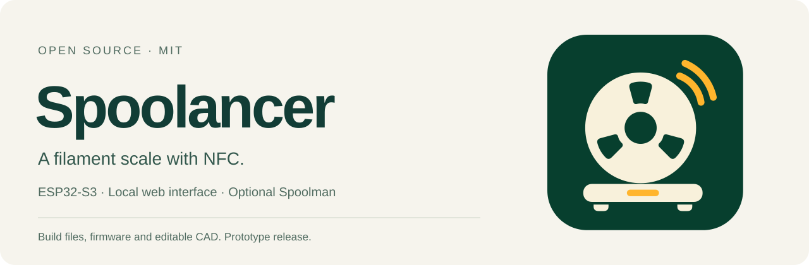
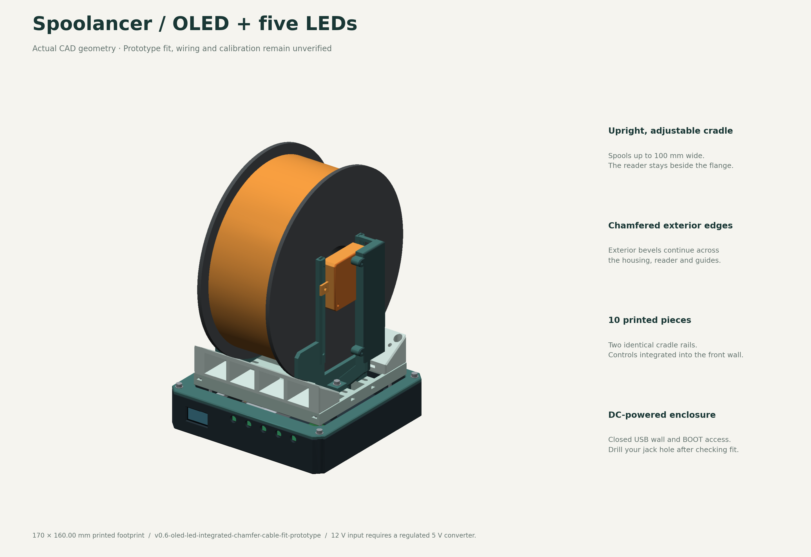
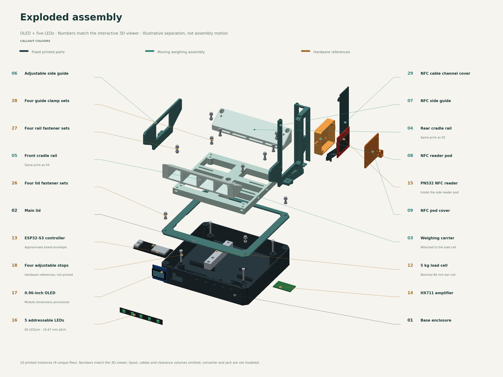
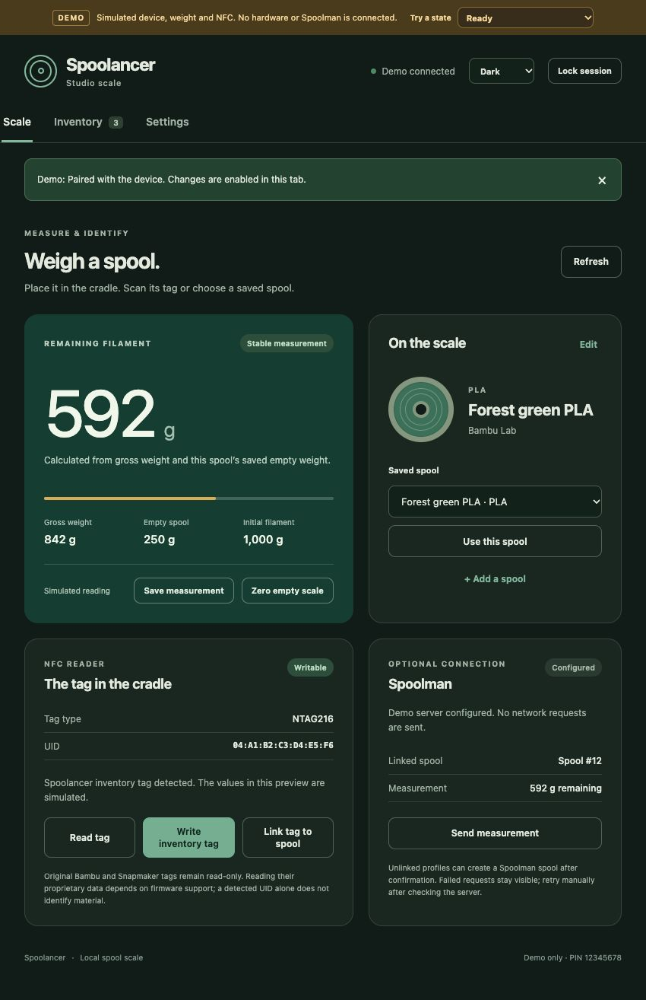

<p align="center"></p>

<p align="center">
  <a href="https://github.com/bloodf/spoolancer/actions/workflows/ci.yml"></a>
  <a href="LICENSE"></a>
  <a href="https://github.com/bloodf/spoolancer/releases/tag/v0.6.0-alpha.1"></a>
</p>

Spoolancer is a standalone filament scale built around an ESP32-S3. Place a spool upright in the cradle, identify it with NFC or a saved profile, and calculate how much filament remains. Manage your inventory in a local web interface and optionally send measurements to Spoolman. The original cases use USB power; the LED variants support a user-installed 12 V jack through a regulated 5 V converter.

**Prototype release:** the software builds and CAD exports have automated checks. One ESP32-S3 has been flashed with the OLED/LED profile and boots with mounted web assets and inventory. Physical fit, display/LED operation, weighing accuracy, seated NFC operation and live Spoolman integration have not yet been validated. Start with the fit samples and the [hardware validation guide](docs/HARDWARE-VALIDATION.md).

[Explore in 3D](https://bloodf.github.io/spoolancer/) · [Start building](docs/BUILD-GUIDE.md) · [Buy parts](docs/BOM.md) · [Print files](docs/PRINTING.md) · [Wiring](WIRING.md) · [Firmware](firmware/README.md) · [Downloads](https://github.com/bloodf/spoolancer/releases/tag/v0.6.0-alpha.1)

## Choose a build

| | Screenless | Capacitive touch |
| --- | --- | --- |
| Controller | ESP32-S3 N16R8, documented dual USB-C V6.0.0 board | ESP-8048S043C-I with integrated ESP32-S3 |
| Controls | Local browser on phone or computer | 800 × 480 touch controls and the same browser interface |
| Printed production pieces | 9 | 12 |
| Fixed footprint | 170 × 160 mm | 170 × 205.73 mm with front holder |
| Wi-Fi recovery | Onboard BOOT | Onboard BOOT |
| Files | [Headless STEP/STL](cad/variants/headless/exports) | [Touch STEP/STL](cad/variants/touch-8048/exports) |

Two additional standalone-controller variants add five addressable RGB lights at 16.667 mm pitch. `headless-led` uses the browser and lights; `oled-led` adds a 0.96-inch 128 × 64 OLED. Both retain onboard BOOT, omit external USB cutouts, and leave the DC-jack hole for the builder to drill. Their component dimensions are provisional: print the LED/OLED fit samples first. See [the variant guide](docs/OLED-RGB-VARIANT.md), [12 V power wiring](docs/DC-POWER.md), [LED-only CAD](cad/variants/headless-led) and [OLED + LED CAD](cad/variants/oled-led).

All four use one 5 kg bar load cell, an HX711 and a PN532. The side reader moves with the cradle and adjusts to a tag on a seated spool. No axle, bearings, separate setup button or perfboard are required. The guides target **50–100 mm spool widths**. The proposed operating range is **20–2,000 g gross spool weight**, with calibration still required. The sensor's 5 kg rating also carries the moving mechanism and is not the supported spool-weight limit.



This is a CAD view, not a photograph of a tested build. The current LED/OLED parts have chamfered exposed edges, integrated vertical front controls and a covered NFC cable route, with functional mounting faces retained. Confirm the actual board, load-cell threads and spool fit before printing a full set.

## Explore the assembly

Open the [interactive 3D assembly](https://bloodf.github.io/spoolancer/) to rotate the model, select numbered parts, hide the spool or housing, and spread the parts apart with the explosion control. The OLED/LED and LED-only models use geometry generated from their printable CAD. Electronics are simplified placement references. The converter and user-drilled jack are not modeled; their actual placement must clear the internal cable route and moving parts.



The [assembly-view guide](docs/ASSEMBLY-VIEW.md) explains controls, component locations and model limits. A self-contained viewer download is available below; it runs on your computer without a CDN connection.

## Download everything

The [prototype pre-release](https://github.com/bloodf/spoolancer/releases/tag/v0.6.0-alpha.1) provides:

- [Headless print bundle](https://github.com/bloodf/spoolancer/releases/download/v0.6.0-alpha.1/spoolancer-v0.6.0-alpha.1-headless-print.zip): 11 matching STEP/STL pairs, including three fit samples, assembly STEP and native FreeCAD.
- [Touch print bundle](https://github.com/bloodf/spoolancer/releases/download/v0.6.0-alpha.1/spoolancer-v0.6.0-alpha.1-touch-8048-print.zip): 14 matching pairs, including three fit samples, assembly STEP and native FreeCAD.
- [Five-LED print bundle](https://github.com/bloodf/spoolancer/releases/download/v0.6.0-alpha.1/spoolancer-v0.6.0-alpha.1-headless-led-print.zip): 14 matching pairs, including five fit samples; ten production pieces; 170 × 160 mm printed footprint.
- [OLED + five-LED print bundle](https://github.com/bloodf/spoolancer/releases/download/v0.6.0-alpha.1/spoolancer-v0.6.0-alpha.1-oled-led-print.zip): 15 matching pairs, including six fit samples; ten production pieces; 170 × 160 mm printed footprint. Both new bundles include editable assemblies and DC/fit instructions.
- [Complete source bundle](https://github.com/bloodf/spoolancer/releases/download/v0.6.0-alpha.1/spoolancer-v0.6.0-alpha.1-source.zip): firmware, web interface, current and historical CAD, generation scripts, project art, tests and documentation.
- [Interactive assembly viewer](https://github.com/bloodf/spoolancer/releases/download/v0.6.0-alpha.1/spoolancer-v0.6.0-alpha.1-assembly-viewer.zip): locally bundled 3D viewer, both current LED models, labels and exploded-view controls. New print bundles also include numbered assembly images.
- [SHA-256 checksums](https://github.com/bloodf/spoolancer/releases/download/v0.6.0-alpha.1/SHA256SUMS.txt) for the downloads.

Each printable part has its own STEP and STL in print orientation, using millimeters. Import individual files into a compatible slicer. Assembly STEP files include electronics/reference bodies and are for inspection, not direct printing. The [print manifest](docs/PRINTING.md) gives quantities and orientation. Editable CAD parameters and scripts are included. No printer-specific G-code or precompiled firmware is distributed in this release.

## Local interface

The ESP32 hosts the interface without an account or cloud service. It includes live weighing, saved spool profiles, brand/material/color fields, a color picker, custom materials, light/dark/system appearance, calibration and NFC actions. Spoolman is optional; local inventory works independently.



Try the simulated interface on your computer:

```sh
git clone https://github.com/bloodf/spoolancer.git
cd spoolancer
python3 -m http.server 8873 --bind 127.0.0.1 --directory web
```

Open <http://127.0.0.1:8873/?demo=1> and pair with **12345678**. The amber demo banner identifies simulated readings. The preview does not contact hardware or Spoolman. The normal device interface never substitutes simulated readings for a disconnected sensor.

For initial bench setup, connect computer USB to the controller's USB-C port; the standalone board uses **COM**. Disconnect any converter supply as described in [DC power](docs/DC-POWER.md) before doing this. Join `Spoolancer-xxxx`, open `http://192.168.4.1`, choose an eight-digit PIN, then hold BOOT for two seconds and release it while the firmware is running. Submit within 60 seconds and configure local Wi-Fi. The temporary setup network is open, and setup credentials use local HTTP; set it up on a trusted network. Full details are in the [first-build guide](docs/BUILD-GUIDE.md).

Hold **BOOT for eight seconds while running** to clear Wi-Fi and pairing, keeping inventory, calibration and Spoolman settings. Holding BOOT during power-on or RST enters programming mode instead. Release BOOT and tap RST to start normally.

The optional touchscreen handles weighing, profile selection, tag actions, save/sync/zero and light/dark appearance. Full metadata editing and connection setup use the browser.

## NFC and printer compatibility

| Tag or service | Current implementation |
| --- | --- |
| NTAG216 inventory tag | Read/write Spoolancer schema 1, confirmed UID and read-back verification |
| Original Bambu Lab / Snapmaker tag | UID-only, read-only; manually link the UID to a local spool profile |
| Custom tags recognized by stock printers | Not implemented; Spoolancer tags do not replace signed printer tags |
| OpenSpool interoperability | Not implemented |
| Spoolman | Optional HTTP connection to a numeric local IPv4 address; explicit create/link and absolute-weight updates |

Remaining filament is **gross spool weight minus a known empty-spool weight**. An unknown tare stays unknown. A saved measurement does not become a live reading. Spoolman retries are manual; uncertain creation responses need reconciliation before retrying. See the [interface/API guide](web/README.md) for the implemented boundaries.

Both printer families use manufacturer-signed MIFARE Classic-family tags; a matching blank chip does not make a printer-compatible tag. [Tag types and stock-firmware limits](docs/NFC-TAGS.md) explains how these differ from Spoolancer's writable NTAG216 inventory.

## Project files and contributing

| Path | Contents |
| --- | --- |
| [`cad/`](cad/README.md) | Editable model, individual STEP/STL files, complete assemblies, checks and renders |
| [`firmware/`](firmware/README.md) | PlatformIO firmware for headless, LED, OLED/LED, integrated touch and legacy ST7789 |
| [`web/`](web/README.md) | Dependency-free browser UI and local demo |
| [`viewer/`](viewer/README.md) | Full 3D assembly, exploded view, component labels and bundled viewer library |
| [`docs/`](docs/BUILD-GUIDE.md) | BOM, printing, assembly, validation and design references |
| [`assets/brand/`](assets/brand/README.md) | Icon PNG, editable SVG and repository banner |
| [`archive/`](archive/README.md) | Superseded designs, preserved for reference |

Read [CONTRIBUTING.md](CONTRIBUTING.md) for local tests and changes, [SECURITY.md](SECURITY.md) for security reporting, and [the evidence record](docs/STATUS.md) for what has and has not been tested. Hardware fit reports with exact board/cell dimensions are especially useful. Use the issue templates to make those results reproducible.

Spoolancer's original code, CAD, documentation and project art use the [MIT license](LICENSE). Dependencies and third-party hardware reference images retain their own rights; see [third-party notices](THIRD_PARTY_NOTICES.md). The initial idea was inspired by [schnoog's filament-spool balance](https://github.com/schnoog/Totally-over-engineered-filament-spool-balance). Spoolancer is an independent project and is not affiliated with printer manufacturers or Spoolman.
