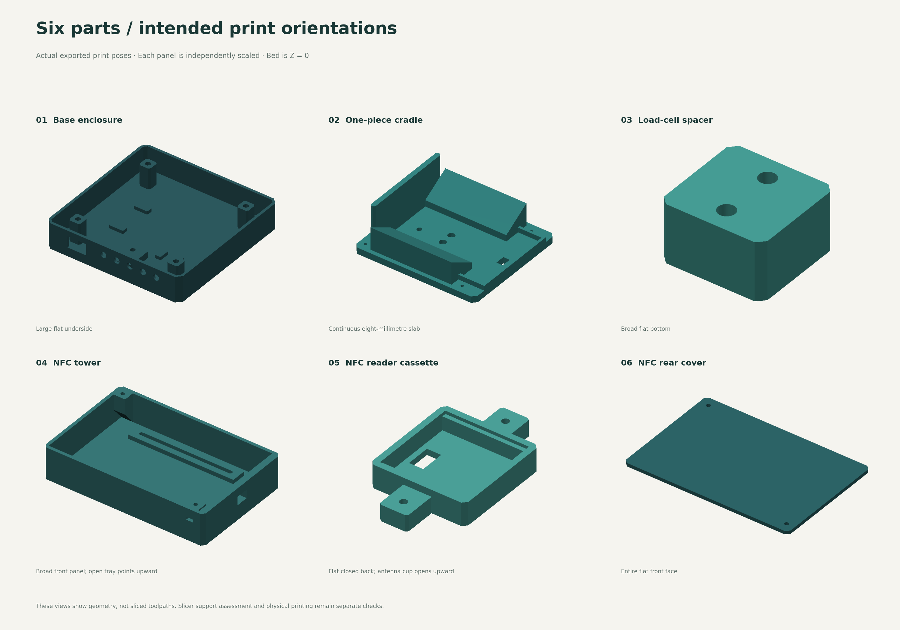

<p align="center"></p>

<p align="center">
  <a href="https://github.com/bloodf/spoolancer/actions/workflows/ci.yml"></a>
  <a href="LICENSE"></a>
  <a href="https://github.com/bloodf/spoolancer/releases/tag/v0.8.0-alpha.1"></a>
</p>

Spoolancer is a standalone filament scale built around an ESP32-S3. Place a spool upright in the cradle, identify it with NFC or a saved profile, and calculate how much filament remains. Manage your inventory in a local web interface and optionally send measurements to Spoolman. The original cases use USB power; the LED variants support a user-installed 12 V jack through a regulated 5 V converter.

**Prototype release:** the software builds and CAD exports have automated checks. One ESP32-S3 has been flashed with the OLED/LED profile and boots with mounted web assets and inventory. Physical fit, display/LED operation, weighing accuracy, seated NFC operation and live Spoolman integration have not yet been validated. Measure your components before printing and follow the [hardware validation guide](docs/HARDWARE-VALIDATION.md).

[Explore in 3D](https://bloodf.github.io/spoolancer/) · [Start building](docs/BUILD-GUIDE.md) · [Buy parts](docs/BOM.md) · [Print files](docs/PRINTING.md) · [Wiring](WIRING.md) · [Firmware](firmware/README.md) · [Downloads](https://github.com/bloodf/spoolancer/releases/tag/v0.8.0-alpha.1)

## Choose a build

The current **v0.8** mechanical design has six printed pieces: base, one-piece cradle, load-cell spacer, NFC support, reader cassette and rear cover. Both versions use your ESP32-S3 N16R8, PN532, HX711 and a 5 kg bar load cell.

| | Five LEDs + web | OLED + five LEDs |
| --- | --- | --- |
| Controller | Standalone ESP32-S3 N16R8 | Same controller |
| Display | Local web interface | 0.96-inch 128 × 64 OLED and web |
| Printed pieces | 6 | 6 |
| Base | 170 × 170 mm | 170 × 170 mm |
| Files | [LED STEP/STL](cad/variants/headless-led/exports) | [OLED STEP/STL](cad/variants/oled-led/exports) |

The fixed cradle accepts the modeled **50–100 mm spool widths and 160–220 mm diameters**. Put the spool upright near the reader-side wall. The reader adjusts vertically; rotate the seated spool to align its tag. There are no sliding side guides, separate rails, hinges or bearings. Narrow spools sit off-center, so calibration and corner-load testing remain necessary.

Both cases have vertical front controls, five LEDs at 16.667 mm pitch, closed USB walls and space for a user-installed DC supply. Drill the jack hole after checking the actual components; **12 V must pass through a regulated 5 V converter**. See [power wiring](docs/DC-POWER.md) and [the indicator guide](docs/OLED-RGB-VARIANT.md).


The new construction uses **12 screws in three sizes**, plus one broad glued joint for the NFC support. Load-cell screws, reader adjustment and the rear cover remain removable. See the [fastener list](docs/BOM.md#current-ledoled-fasteners) and [assembly instructions](docs/ASSEMBLY.md). This is a CAD prototype; printed strength, adhesive retention, fit and weighing are untested. The proposed operating range remains 20–2,000 g gross spool weight. The sensor's 5 kg rating also carries the moving mechanism.

The original [screenless USB design](cad/variants/headless) and [800 × 480 integrated-touch design](cad/variants/touch-8048) remain available as **legacy mechanical versions**. Their old parts do not fit the new six-piece mechanism. Firmware support is unchanged.

## Explore the assembly

Open the [interactive 3D assembly](https://bloodf.github.io/spoolancer/) to rotate the model, select numbered parts, hide the spool or housing, and spread the parts apart with the explosion control. The OLED/LED and LED-only models use geometry generated from their printable CAD. Electronics are simplified placement references. The converter and user-drilled jack are not modeled; their actual placement must clear the internal cable route and moving parts.


The [assembly-view guide](docs/ASSEMBLY-VIEW.md) explains controls, component locations and model limits. A self-contained viewer download is available below; it runs on your computer without a CDN connection.

## Download everything

The [v0.8 prototype pre-release](https://github.com/bloodf/spoolancer/releases/tag/v0.8.0-alpha.1) provides:

- [OLED + five-LED print bundle](https://github.com/bloodf/spoolancer/releases/download/v0.8.0-alpha.1/spoolancer-v0.8.0-alpha.1-oled-led-print.zip): six STEP/STL pairs, native FreeCAD, full assembly STEP, assembly views and instructions.
- [Five-LED print bundle](https://github.com/bloodf/spoolancer/releases/download/v0.8.0-alpha.1/spoolancer-v0.8.0-alpha.1-headless-led-print.zip): the same mechanism, with a base without the OLED opening.
- [Complete source](https://github.com/bloodf/spoolancer/releases/download/v0.8.0-alpha.1/spoolancer-v0.8.0-alpha.1-source.zip) and [offline assembly viewer](https://github.com/bloodf/spoolancer/releases/download/v0.8.0-alpha.1/spoolancer-v0.8.0-alpha.1-assembly-viewer.zip).
- Legacy [headless](https://github.com/bloodf/spoolancer/releases/download/v0.8.0-alpha.1/spoolancer-v0.8.0-alpha.1-headless-print.zip) and [integrated-touch](https://github.com/bloodf/spoolancer/releases/download/v0.8.0-alpha.1/spoolancer-v0.8.0-alpha.1-touch-8048-print.zip) bundles, clearly separated from v0.8 mechanics.
- [SHA-256 checksums](https://github.com/bloodf/spoolancer/releases/download/v0.8.0-alpha.1/SHA256SUMS.txt).



Each printable part has its own STEP and STL in print orientation, using millimeters. Import individual files into a compatible slicer. Assembly STEP files include electronics/reference bodies and are for inspection, not direct printing. The [print manifest](docs/PRINTING.md) gives quantities and orientation. Editable CAD parameters and scripts are included. No printer-specific G-code or precompiled firmware is distributed in this release.

## Local interface

The ESP32 hosts the interface without an account or cloud service. It includes live weighing, saved spool profiles, brand/material/color fields, a color picker, custom materials, light/dark/system appearance, calibration and NFC actions. Spoolman is optional; local inventory works independently.


Try the simulated interface on your computer:

```sh
git clone https://github.com/bloodf/spoolancer.git
cd spoolancer
python3 -m http.server 8873 --bind 127.0.0.1 --directory web
```

Open <http://127.0.0.1:8873/?demo=1> and pair with **12345678**. The amber demo banner identifies simulated readings. The preview does not contact hardware or Spoolman. The normal device interface never substitutes simulated readings for a disconnected sensor.

For initial bench setup, connect computer USB to the controller's USB-C port; the standalone board uses **COM**. Disconnect any converter supply as described in [DC power](docs/DC-POWER.md) before doing this. Join `Spoolancer-xxxx`, open `http://192.168.4.1`, choose an eight-digit PIN, then hold BOOT for two seconds and release it while the firmware is running. Submit within 60 seconds and configure local Wi-Fi. The temporary setup network is open, and setup credentials use local HTTP; set it up on a trusted network. Full details are in the [first-build guide](docs/BUILD-GUIDE.md).

Hold **BOOT for eight seconds while running** to clear Wi-Fi and pairing, keeping inventory, calibration and Spoolman settings. Holding BOOT during power-on or RST enters programming mode instead. Release BOOT and tap RST to start normally.

The optional touchscreen handles weighing, profile selection, tag actions, save/sync/zero and light/dark appearance. Full metadata editing and connection setup use the browser.

## NFC and printer compatibility

| Tag or service | Current implementation |
| --- | --- |
| NTAG216 inventory tag | Read/write Spoolancer schema 1, confirmed UID and read-back verification |
| Original Bambu Lab / Snapmaker tag | UID-only, read-only; manually link the UID to a local spool profile |
| Custom tags recognized by stock printers | Not implemented; Spoolancer tags do not replace signed printer tags |
| OpenSpool interoperability | Not implemented |
| Spoolman | Optional HTTP connection to a numeric local IPv4 address; explicit create/link and absolute-weight updates |

Remaining filament is **gross spool weight minus a known empty-spool weight**. An unknown tare stays unknown. A saved measurement does not become a live reading. Spoolman retries are manual; uncertain creation responses need reconciliation before retrying. See the [interface/API guide](web/README.md) for the implemented boundaries.

Both printer families use manufacturer-signed MIFARE Classic-family tags; a matching blank chip does not make a printer-compatible tag. [Tag types and stock-firmware limits](docs/NFC-TAGS.md) explains how these differ from Spoolancer's writable NTAG216 inventory.

## Project files and contributing

| Path | Contents |
| --- | --- |
| [`cad/`](cad/README.md) | Editable model, individual STEP/STL files, complete assemblies, checks and renders |
| [`firmware/`](firmware/README.md) | PlatformIO firmware for headless, LED, OLED/LED, integrated touch and legacy ST7789 |
| [`web/`](web/README.md) | Dependency-free browser UI and local demo |
| [`viewer/`](viewer/README.md) | Full 3D assembly, exploded view, component labels and bundled viewer library |
| [`docs/`](docs/BUILD-GUIDE.md) | BOM, printing, assembly, validation and design references |
| [`assets/brand/`](assets/brand/README.md) | Icon PNG, editable SVG and repository banner |
| [`archive/`](archive/README.md) | Superseded designs, preserved for reference |

Read [CONTRIBUTING.md](CONTRIBUTING.md) for local tests and changes, [SECURITY.md](SECURITY.md) for security reporting, and [the evidence record](docs/STATUS.md) for what has and has not been tested. Hardware fit reports with exact board/cell dimensions are especially useful. Use the issue templates to make those results reproducible.

Spoolancer's original code, CAD, documentation and project art use the [MIT license](LICENSE). Dependencies and third-party hardware reference images retain their own rights; see [third-party notices](THIRD_PARTY_NOTICES.md). The initial idea was inspired by [schnoog's filament-spool balance](https://github.com/schnoog/Totally-over-engineered-filament-spool-balance). Spoolancer is an independent project and is not affiliated with printer manufacturers or Spoolman.
