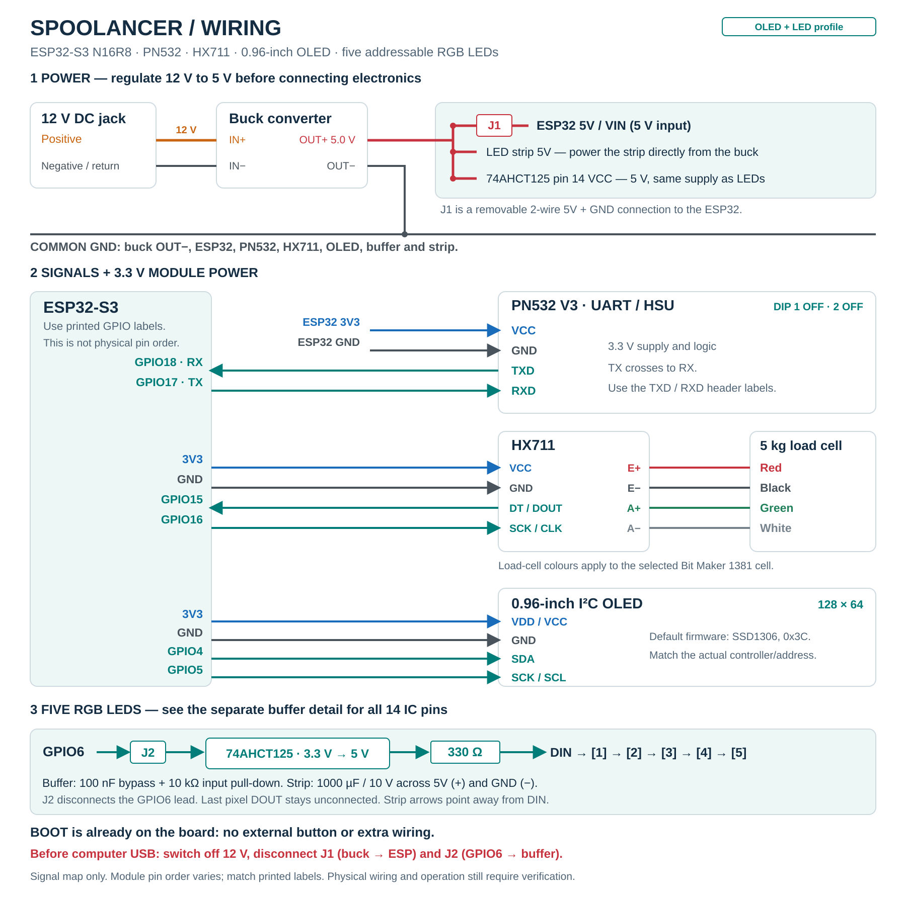
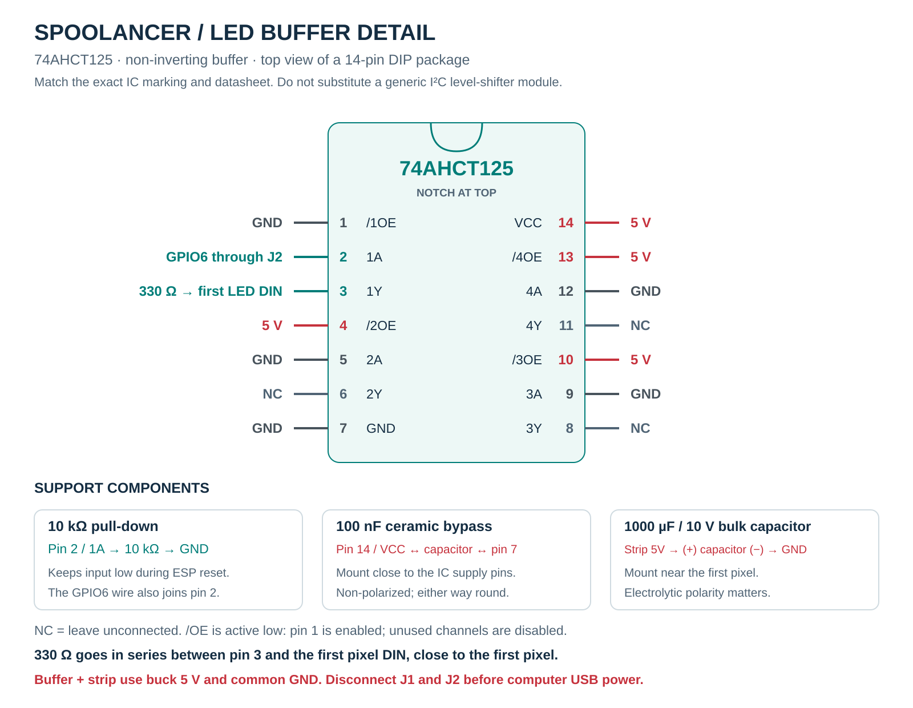

# Spoolancer wiring guide

This guide wires the **standalone ESP32-S3 N16R8, PN532, HX711, 5 kg load cell, 0.96-inch OLED and five addressable LEDs**, powered from a **12 V jack through a 5 V buck converter**. It follows the current firmware pins and v0.8 six-piece enclosure. For the LED-only build, omit the OLED. For a plain headless build, omit the OLED and the entire LED/buffer branch.

**Start with all power disconnected, including computer USB. Never connect 12 V to the ESP32, LEDs or peripherals.** Check the received modules against their specifications before powering them. Firmware startup has been observed on one controller; this complete circuit has not yet been bench-tested.

## Wiring drawings

Use the drawings alongside the connection tables. They show electrical connections, not the physical order of breakout headers.



[Full-size wiring drawing](docs/wiring/spoolancer-wiring-overview.svg) · [PNG copy](docs/wiring/spoolancer-wiring-overview.png) · [LED buffer detail](docs/wiring/spoolancer-led-buffer.svg) · [Component positions and exploded view](https://bloodf.github.io/spoolancer/?model=oled-led)

## 1. Identify the parts

| Part | Required configuration |
| --- | --- |
| ESP32 | Standalone N16R8 board matching the [owned V6.0.0 board photo](docs/reference/esp32-s3-n16r8-v6.png) |
| PN532 | Red V3-style module, UART/HSU mode; [reference photo](docs/reference/pn532-v3-listing.png) |
| HX711 | Selected single-supply 3.3 V-compatible breakout; VCC, GND, DT/DOUT and SCK/CLK |
| Load cell | Selected four-wire 5 kg bar cell; connect to HX711 channel A |
| OLED | Four-pin I²C module, verified for 3.3 V supply and logic; provisional SSD1306, address `0x3c` |
| LEDs | Exactly five 5 V addressable pixels; provisional WS2812-style GRB/800 kHz |
| Power | DC jack matching the 12 V adapter, plus a regulated 5 V buck converter rated for at least 2 A continuous at 12 V input |
| LED buffer | 74AHCT125 powered from 5 V; a suitable assembled module avoids perfboard |
| Small parts | One 330 Ω series resistor, one 10 kΩ pull-down, one 100 nF ceramic capacitor, one 1000 µF electrolytic capacitor rated 10 V or higher |
| Harness | Flexible stranded wire, insulated joints, removable connectors and strain relief |

The strip's three wires establish that it is addressable, but do not identify its chip or color order. Likewise, 0.96-inch size does not identify an OLED controller. Confirm both if their behavior differs from the defaults. See [firmware options](firmware/README.md#five-leds-and-optional-096-inch-oled).

Use printed **GPIO numbers**, not header positions. On the ESP32, `17` means GPIO17. The header pins labeled `TX` and `RX` are the programming UART and are **not** the PN532 connections in this build. Leave GPIO35–37 for octal memory, GPIO19–20 for native USB and GPIO43–44 for programming. BOOT already connects to GPIO0; do not add button wiring.

## 2. Wire the power supply

The following is the recommended **5 V header connection**, with no internal USB power plug required. Use the development board's header explicitly marked **5V / 5Vin**. Do not treat a generic `VIN` label as permission to supply 12 V.

```text
12 V adapter → DC jack → buck converter IN+ / IN−
                              │
                         regulated 5.0 V
                              │
                 ┌────────────┴───────────────┐
                 │                           │
       J1 removable 5V/GND pair       LED + buffer branch
                 │                           │
          ESP32 5V / GND             strip 5V + buffer VCC
                 │
        board's 3V3 / GND
                 │
           PN532 + HX711 + OLED

All grounds share the converter OUT− / GND connection.
LED current returns directly to the converter, not through an ESP32 jumper.
```

| From | To | Note |
| --- | --- | --- |
| DC jack positive terminal | Buck `IN+` | Verify jack terminals and adapter polarity with a meter |
| DC jack negative terminal | Buck `IN−` | A third, switched jack contact is not automatically ground |
| Buck `OUT+`, adjusted to 5.0 V | ESP32 `5V / 5Vin`, through removable **J1** | Never to `3V3` |
| Buck `OUT−` | ESP32 `GND`, through J1 | Two-wire removable controller power connection |
| Buck `OUT+` | LED strip `5V` and buffer `VCC` | Separate supply branch |
| Buck `OUT−` | LED strip `GND` and buffer `GND` | Common ground, direct return |
| ESP32 `3V3` | PN532 `VCC`, HX711 `VCC`, OLED `VDD/VCC` | Only for the compatible modules described here |
| ESP32 `GND` | PN532 `GND`, HX711 `GND`, OLED `GND` | Common peripheral ground |

1. Connect only the jack and converter. Keep the ESP32, strip and buffer disconnected.
2. Apply 12 V and measure the converter output. Set an adjustable converter to **5.0 V**, then secure its adjustment against accidental movement.
3. Remove power and wait for the output to discharge before connecting electronics.
4. Use insulated connectors or soldered and insulated branches for distribution. Do not force several wires into one jumper socket. For short internal runs, 22 AWG stranded wire is a practical choice for supply/return; use thinner flexible leads for signals, especially the moving reader.
5. Mount the insulated converter on a fixed enclosure wall, clear of the load cell and cradle. Keep its ventilation and heat-producing components unobstructed. Check operation and temperature under the complete load before closing the case.

Only use **one controller power source at a time**. The clone board's USB/header isolation has not been verified. Follow the [USB programming sequence below](#10-usb-programming-and-service), even when the 12 V adapter is unplugged. [Espressif documents USB and header power as alternative supplies](https://docs.espressif.com/projects/esp-dev-kits/en/latest/esp32s3/esp32-s3-devkitc-1/user_guide_v1.1.html#power-supply-options).

## 3. Connect the PN532 NFC reader

With power off, set **switch 1 OFF and switch 2 OFF** for **UART/HSU**. Follow the switch numbers and printed ON mark, rather than a photograph's orientation. Power-cycle after changing the mode.

| PN532 label | ESP32 connection |
| --- | --- |
| `VCC` | `3V3` |
| `GND` | `GND` |
| `TXD` | `GPIO18` — ESP32 receives |
| `RXD` | `GPIO17` — ESP32 transmits |

TX connects to RX in each direction. On this V3-style board, use the UART labels for the shared four-pin UART/I²C header; the labels may be on its reverse side. The SPI header is unused. Do not connect IRQ or reset wires for this firmware.

The firmware selects **115200 baud, 8N1**, on GPIO18/17. The [Elechouse V3 manual](https://www.elechouse.com/elechouse/images/product/PN532_module_V3/PN532_%20Manual_V3.pdf) specifies the OFF/OFF HSU setting and 3.3–5 V module supply. This guide uses **3.3 V**. Check that your clone matches before applying power; do not change it to 5 V while assuming its UART output remains safe for the ESP32.

## 4. Connect the HX711 and load cell

First connect the amplifier to the ESP32:

| HX711 label | ESP32 connection |
| --- | --- |
| `VCC` | `3V3` |
| `GND` | `GND` |
| `DT` / `DOUT` | `GPIO15` |
| `SCK` / `CLK` | `GPIO16` |

Then connect the **selected Bit Maker code 1381 load cell** to the HX711:

| Cell wire | HX711 terminal | Function |
| --- | --- | --- |
| Red | `E+` | Bridge excitation positive |
| Black | `E−` | Bridge excitation negative |
| Green | `A+` | Measurement positive |
| White | `A−` | Measurement negative |

Leave `B+` and `B−` unused. The firmware selects **channel A, gain 128**. Leave the breakout's rate configuration at its default unless its documentation calls for a change; the firmware does not control a RATE pin.

These colors come from the [selected load-cell listing](https://www.bitmaker.com.br/sensor-de-peso-c-lula-de-carga-5kg), not a universal convention. A different cell needs its own wiring specification. The [selected single-supply HX711 board](https://www.bitmaker.com.br/m-dulo-conversor-hx711-adc-24-bits-para-sensor-de-peso) is listed for 3–5 V; use **3.3 V** here. Do not copy the separate `VCC`/`VDD` wiring of another manufacturer's breakout onto this board. Do not connect the cell directly to ESP32 pins.

Keep the cell cable short and away from the converter and LED power wires. Do not clamp its sensing section, cover it in glue or pull on its cable. Wire color and electrical response cannot establish correct mechanical mounting; follow the [cell assembly steps](docs/ASSEMBLY.md#2-fit-electronics-and-the-fixed-cell-end).

## 5. Connect the OLED

| OLED label | ESP32 connection |
| --- | --- |
| `GND` | `GND` |
| `VDD` / `VCC` | `3V3` |
| `SCK` / `SCL` | `GPIO5` |
| `SDA` | `GPIO4` |

The pictured four-pin screen uses **I²C**, even though its clock is marked `SCK`. Use its printed labels; similar displays can have a different pin order. Verify 3.3 V operation and keep any I²C pull-ups at 3.3 V. No separate backlight wire is required.

The `spoolancer-oled-led` build defaults to SSD1306 at `0x3c`. If the actual controller is SH1106 or its address is `0x3d`, use the [documented build options](firmware/README.md#five-leds-and-optional-096-inch-oled). An address acknowledgement alone does not identify the controller. For the LED-only build, leave GPIO4 and GPIO5 unconnected.

## 6. Connect the five LEDs and logic buffer

Use five consecutive pixels cut only at the strip's marked cut pads. Connect at the **DIN end**, following its arrows toward pixels 2–5. The strip already carries power and data between adjacent pixels; the fifth pixel's DOUT remains unconnected.

```text
ESP32 GPIO6 → removable signal connector J2 → 74AHCT125 input
                                                 │
                                           10 kΩ to GND

74AHCT125 output → 330 Ω resistor → first pixel DIN → pixels 2–5
       VCC → buck 5 V                 strip 5V → buck 5 V
       GND → common GND               strip GND → common GND
```

Place the **330 Ω resistor near the first pixel's DIN**. Put the **1000 µF, 10 V or higher** electrolytic across the strip's input power: **positive to 5 V, negative/striped side to GND**. This capacitor is on the 5 V side, never on the 12 V input. Put a **100 nF ceramic capacitor** directly across the buffer's VCC and GND connections.

Use a fast non-inverting **74AHCT125** buffer powered from **5 V**. Its input accepts the ESP32's 3.3 V logic. A generic bidirectional BSS138 I²C level-shifter board is not the specified substitute. With a preassembled AHCT buffer module, follow its labeled input, output, supply and enable connections; module header numbering is not the IC's pin numbering. Check whether its bypass capacitor and input pull-down are already fitted.

### Exact 14-pin 74AHCT125 wiring

For a **14-pin DIP package viewed from above**, put the notch at the top: pin 1 is top left, pin 7 bottom left, pin 8 bottom right and pin 14 top right. Check the package marking before soldering. A bare IC needs an insulated, strain-relieved assembly; an assembled buffer module avoids building that carrier.

| IC pin | Name | Connect to |
| --- | --- | --- |
| 1 | `/1OE` | GND, enables channel 1 |
| 2 | `1A` | ESP32 GPIO6 through J2; also a 10 kΩ resistor to GND |
| 3 | `1Y` | 330 Ω resistor, then strip DIN |
| 4 | `/2OE` | 5 V, disables unused channel 2 |
| 5 | `2A` | GND |
| 6 | `2Y` | Leave unconnected |
| 7 | `GND` | Common GND |
| 8 | `3Y` | Leave unconnected |
| 9 | `3A` | GND |
| 10 | `/3OE` | 5 V, disables unused channel 3 |
| 11 | `4Y` | Leave unconnected |
| 12 | `4A` | GND |
| 13 | `/4OE` | 5 V, disables unused channel 4 |
| 14 | `VCC` | Buck 5 V |

The 100 nF capacitor connects pins **14 and 7**, close to the IC. The 10 kΩ pull-down keeps the enabled input defined during ESP32 reset. Unused inputs are tied off and unused outputs stay open. The pinout and logic levels follow [TI's SN74AHCT125 datasheet](https://www.ti.com/lit/gpn/sn74ahct125); the series resistor and bulk capacitor follow [Adafruit's NeoPixel wiring guidance](https://learn.adafruit.com/adafruit-neopixel-uberguide/best-practices).



The default firmware drives five GRB/800 kHz pixels at **20% brightness**. Brightness limiting is not a substitute for suitable wiring or supply capacity. Incorrect colors can mean a different RGB order or RGBW strip; identify the chip before changing the [firmware options](firmware/README.md#five-leds-and-optional-096-inch-oled).

## 7. Route the wiring inside the six-piece case

**The ESP32, HX711, OLED, LED strip, buffer and converter stay in the fixed base.** The reader and its tower move with the weighed cradle.

1. Route the PN532's four fine, flexible leads out of its cassette into the tower's rear tray.
2. Leave a broad slack loop inside the tray for the full **85–170 mm reader-height travel**. Cover it with the flat rear cover after checking movement.
3. Pass the tail through the tower/cradle opening into the base. Include a second loose transition between the moving cradle and fixed base; do not pull it taut or bridge the gap with glue or a stiff cable tie.
4. Add strain relief away from the moving transition and a removable four-wire connection near the fixed electronics. Label both halves `3V3`, `GND`, `TXD→18`, `RXD←17`; do not rely only on connector orientation.
5. Keep reader wires clear of the spool, clamp screws, cover screws, cell flexure and stop heads. Keep front-panel wiring in the fixed base, away from the BOOT probe path.

The current bay is fixed-width: there are **no sliding side guides or width-adjustment rails**. Test wiring at both reader-height extremes. Zero the complete empty assembly after repositioning the reader. If the settled reading changes when the cable is touched or rerouted, fix the cable force before calibration. See the [illustrated assembly sequence](docs/ASSEMBLY.md#4-fit-the-reader-and-hidden-wiring).

## 8. BOOT button and firmware selection

No external button, button resistor or button perfboard is needed. Use onboard **BOOT**, already on GPIO0:

| Action, with firmware already running | Result |
| --- | --- |
| Hold 2 seconds, then release before 8 seconds | Allows one PIN-enrollment attempt for 60 seconds |
| Hold 8 seconds, then release | Clears Wi-Fi and pairing; retains inventory, calibration and Spoolman settings |
| Press RST | Restarts; does not erase Wi-Fi |

BOOT held during power-on or RST enters the programming bootloader. Release BOOT and press RST to run normally. This is distinct from the Wi-Fi gesture, as described in [Espressif's boot-mode documentation](https://docs.espressif.com/projects/esptool/en/latest/esp32s3/advanced-topics/boot-mode-selection.html). The top access hole is provisional: verify its alignment to the actual button, remove the spool and use a blunt nonconductive probe.

| Your build | Firmware environment |
| --- | --- |
| OLED and five LEDs | `spoolancer-oled-led` |
| Five LEDs, browser only | `spoolancer-headless-led` |
| No display or LEDs | `spoolancer-headless` |

Build and upload **both firmware and web assets** using the [installation guide](firmware/README.md#build-and-install). The default PlatformIO environment is plain headless, so explicitly select `spoolancer-oled-led` for this circuit. The legacy `spoolancer-s3` environment uses GPIO4/5/6 for buttons and must not be used with this OLED/LED wiring. The authoritative map is [Pins.h](firmware/include/Pins.h).

## 9. First power-up and checks

Make connections only with both DC and USB disconnected. Keep the assembly open until each stage works.

1. **Inspect the unpowered circuit.** Check connector polarity, solder bridges, stray strands, capacitor polarity and insulated joints. Verify that 12 V reaches only the converter input. Make sure no persistent short exists between 5 V and GND; charging capacitors can cause a brief meter indication.
2. **Check the converter alone.** Confirm 5.0 V with all loads disconnected, then remove power.
3. **Start the ESP32 alone from the converter.** Leave USB and all peripheral harnesses disconnected, including signal wires and GPIO6/J2. Do not drive an unpowered module through a signal pin. Verify the board's 3V3 rail and normal startup. If programming is needed first, use the isolation sequence below.
4. **Add the HX711/load cell, then PN532, then OLED.** Power off between additions. Check that 3V3 remains steady and the controller still starts. A USB boot with no peripherals does not establish regulator capacity with all modules active.
5. **Add the buffer and LED branch.** Recheck 5 V under load. In setup mode the five LEDs should pulse blue; the OLED should show status/address. Stop and disconnect power if a component becomes unexpectedly hot or the supply collapses.
6. **Set up the browser.** Join `Spoolancer-xxxx` and open `http://192.168.4.1`. Choose an eight-digit PIN, hold/release BOOT for two seconds, submit within 60 seconds and configure local Wi-Fi. The setup AP is open and uses HTTP; perform enrollment in a trusted location. See [first use](firmware/README.md#headless-first-use).
7. **Check the sensors.** Check `/api/status` for `nfc.available: true` and inspect `nfc.last_error`, then test one known inventory tag. Check that scale data becomes fresh. Before calibration, missing grams or a calibration-required message is expected. `/api/status` exposes `nfc.available`, `nfc.last_error`, `scale.fresh` and `scale.stable` for diagnosis; it does not expose raw HX711 counts or a numeric PN532 firmware version.
8. **Finish assembly and calibrate.** Zero the complete empty cradle, calibrate with a known 100–2000 g mass and check independent masses. Repeat placements, reader-height changes and tests with LEDs on/off. The 5 kg cell also carries the moving mechanism; the firmware's intended gross-spool range is up to 2 kg.

A working display or recognized tag does not prove calibrated weighing. Record actual results in the [hardware validation report](docs/HARDWARE-VALIDATION.md). Use a known supported NTAG216 for inventory write tests; the appearance of the supplied key fob/card does not establish its tag type.

## 10. USB programming and service

For the current enclosure, remove the spool, free/disconnect the reader tail, remove the **two moving-end M4 screws** and lift the cradle while supporting the separate cell spacer. Leave the fixed-end M5 screws installed. There is no separate main lid. See [service access](docs/ASSEMBLY.md#6-service-and-acceptance).

Before plugging a computer into the ESP32's **COM USB-C port**:

1. Unplug the 12 V adapter and wait for the converter output to discharge.
2. Unplug **J1**, the converter's two-wire 5V/GND connection to the ESP32. Unplugging only the adapter is insufficient: USB can otherwise backfeed the converter.
3. Unplug **J2**, the GPIO6 lead into the LED buffer, so the USB-powered ESP32 cannot drive an unpowered buffer. Keep the LED/buffer branch off. If your harness groups these connections, unplug that complete harness instead.
4. Attach the computer's USB data cable to **COM** and program the board. Do not reconnect DC while USB is attached.
5. Remove USB before reconnecting J1/J2 and restoring 12 V.

The PN532, HX711 and OLED can remain connected to the ESP32's 3V3 rail during USB programming if that rail supplies them reliably. Do not run them from a separate supply during this sequence. An internal USB-C power plug is an alternative to J1, not an additional supply path; it must be unplugged and replaced by the computer cable for service. Its fit is not established by the CAD.

## Troubleshooting

| Symptom | Check, with power removed before changing wires |
| --- | --- |
| No boot or repeated resets | Measure 5 V and 3V3 under load; verify ground, polarity, supply capacity and absence of shorts. Disconnect added loads to isolate the cause |
| Board stays in download mode | Release BOOT, then press RST once |
| No setup network on a previously configured unit | Hold BOOT for 8 seconds while running, then release; this also clears pairing |
| NFC reader offline | Both switches OFF, power-cycle, 3.3 V supply, TXD→18 and RXD→17, UART header rather than SPI/programming TX/RX; restart after repair |
| Reader online but tag not read | Use one tag, align antenna/tag, check distance through the panel and keep metal away; identify the tag type |
| Scale data not fresh | HX711 VCC/GND, DT15/CLK16, solder joints and the correct firmware profile |
| Fresh scale data but wrong/drifting weight | Correct cell wiring and calibration; clear stops, free flexure, loose reader cable, firm mounting; compare LED on/off readings |
| OLED blank | `spoolancer-oled-led` selected, 3.3 V supply, SDA4/SCL5, actual controller/address; restart after correcting wiring |
| LEDs dark/flickering | 5 V/common ground, DIN end, GPIO6, buffer enable, series resistor, input pull-down, capacitor and correct LED firmware profile |
| LEDs show wrong colors | Identify RGB vs RGBW and channel order before changing build flags |
| Wi-Fi cannot see the device after setup | Use the LAN address shown during setup; `spoolancer.local` depends on network mDNS support |

## Shared peripherals, different pins

This appendix preserves the alternate controller map. **Do not apply the standalone OLED/LED drawing to the integrated touchscreen.**

| Connection | Standalone N16R8 | ESP-8048S043C-I integrated touch |
| --- | --- | --- |
| PN532 `TXD` | GPIO18 | GPIO13 |
| PN532 `RXD` | GPIO17 | GPIO11 |
| HX711 `DT` | GPIO15 | GPIO12 |
| HX711 `SCK` | GPIO16 | GPIO17 |
| PN532/HX711 power | 3V3/GND | Verified 3V3/GND pads |
| BOOT | Existing GPIO0 button | Existing GPIO0 button |

The integrated display has its own ESP32-S3 and uses `spoolancer-touch-8048`. Its panel and GT911 are wired internally; it is not a display peripheral of the standalone board. GPIO11/12/13 reuse its SD interface: leave the SD slot empty; firmware holds SD CS10 high. No external five-LED/OLED wiring is defined for this profile. Check the delivered revision and connector labels before connecting anything. See [touchscreen details](firmware/README.md#esp-8048s043c-i-touchscreen-variant).

The legacy `spoolancer-s3` build uses the standalone PN532/HX711 map plus ST7789 CLK12, MOSI11, CS10, DC9, RST8, and buttons Previous4, Next5, Select6 to GND. Its instructions remain in the [archived wiring guide](archive/v0.3-compact/WIRING.md).
