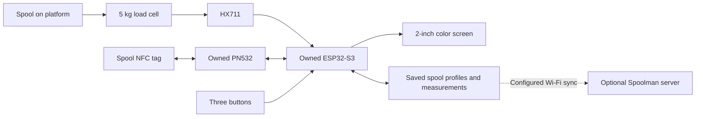

# Spoolancer build plan

Planning draft, 26 October 2026. This document records a proposed design and source research. No hardware, firmware, tag writing, or printer compatibility has been tested for this build yet.

Build an open-source, standalone USB-powered bench scale that identifies a filament spool, shows its remaining filament, reads or writes supported NFC tags, and sends accepted measurements to Spoolman when configured. Use the ESP32-S3 N16R8 and PN532 already owned. The user has both Bambu Lab and Snapmaker U1 printers; the scale must work independently of either printer.

The user confirmed occasional weighing before or after printing. The spool will lie flat on the platform. Assume standard spools containing up to 1 kg of filament and up to 2 kg gross spool weight for the first version; larger spools require a mechanical review.

The user confirmed that the Snapmaker U1 will keep its stock firmware. Writable tags are for the scale's inventory. Reading original Snapmaker tags remains a core feature.

The main interaction is simple: scan the spool, place it on the platform, and read its material, color, and remaining grams. Writing a tag is a separate deliberate action with a preview and read-back verification.

**The scale can read original Bambu Lab and Snapmaker tags, but creating arbitrary tags accepted by stock printers is a separate limitation.** Both manufacturers use signed data. Ordinary writable NFC stickers do not bypass that requirement.

| Capability | Planned support | Evidence or condition |
| --- | --- | --- |
| Weigh a spool and show remaining filament | Core feature | Requires calibration and a known empty-spool weight |
| Identify original Bambu Lab tags | Core feature | Published authentication and decoding; validate actual samples |
| Identify original Snapmaker U1 tags | Core feature | Published UID-derived authentication and decoding; validate actual samples |
| Read and write our own inventory tags | Core feature | NTAG215/216 with an OpenSpool NDEF record; NTAG216 preferred for space |
| Send measured remaining filament to Spoolman | First-version feature, optional configuration | Requires a server URL, an explicit Spoolman spool ID mapping and a known empty-spool weight; offline weighing remains available |
| Make custom tags recognized directly by stock Bambu AMS | Unavailable for arbitrary profiles | Modifying signed material/color data invalidates the signature |
| Make custom tags recognized directly by stock U1 | Unavailable for arbitrary profiles | Stock firmware requires Snapmaker's proprietary tags |
| Configure Bambu filament settings through a network integration | Later option | Exact printer, AMS, firmware and supported integration must be checked |

The Bambu limitations and cloning distinction are documented in the [Bambu RFID research guide](https://github.com/queengooborg/Bambu-Lab-RFID-Tag-Guide). Snapmaker's stock behavior is documented in its [U1 FAQ](https://wiki.snapmaker.com/en/FAQ/u1). The [Snapmaker tag protocol](https://github.com/DnG-Crafts/U1-RFID/blob/main/docs/U1%20Tag%20Protocol.md) and [published key derivation](https://github.com/DnG-Crafts/U1-RFID/blob/main/docs/fm175xx_reader.py) provide the standalone reader path. Neither reader requires printer credentials to derive the documented tag authentication keys.

Exact copies of genuine Bambu tags are a narrower possibility. They preserve the original signed profile and require suitable clone media. An [ESP32 RFID workbench](https://github.com/kaver79/esp32-bambu-rfid-reader) reports a PN5180/FUID clone accepted by an A1 Combo with AMS Lite. That does not establish cloning with the owned PN532 or arbitrary material editing. Cloning is outside the first build.

**Use the existing electronics and add these parts.**

| Part | Quantity | Selection |
| --- | --- | --- |
| ESP32-S3 N16R8 development board | 1, owned | Supplied photo shows a 44-pin board marked V6.0.0; proposed GPIO assignments are in WIRING.md |
| PN532 reader/writer | 1, owned | Supplied image shows a red Elechouse-style NFC MODULE V3; use HSU with both switches OFF |
| Color display | 1 | [Waveshare 2inch LCD Module, SKU 17344](https://www.waveshare.com/2inch-lcd-module.htm), non-touch ST7789 SPI, 240 × 320 |
| Load cell | 1 | [Bit Maker code 1381](https://www.bitmaker.com.br/sensor-de-peso-c-lula-de-carga-5kg), four-wire 5 kg bar cell, 80 × 12.7 × 12.7 mm |
| Load-cell amplifier | 1 | [Bit Maker HX711 code 0679](https://www.bitmaker.com.br/m-dulo-conversor-hx711-adc-24-bits-para-sensor-de-peso), documented 3–5 V supply; use 3.3 V |
| Push buttons | 3 | SmartKits SK1798, momentary 6 × 6 × 7 mm; previous, next and select; long select returns |
| Writable tags | 5 | SmartKits SK6052 NTAG216 stickers, for local inventory |
| Assembly materials | As needed | Printed base and tray, matching load-cell screws, standoffs, wire and nonslip feet |
| Power and calibration | 1 set | USB supply/cable and known reference masses |

The user supplied these component listings on 26 October 2026: [AliExpress listing 1005009519771350](https://pt.aliexpress.com/item/1005009519771350.html) and [AliExpress listing 1005009330328373](https://pt.aliexpress.com/item/1005009330328373.html). Their contents could not be inspected because text retrieval failed and browser access was blocked. The user subsequently supplied an [ESP32 board image](docs/reference/esp32-s3-n16r8-v6.png) and a [PN532 product image](docs/reference/pn532-v3-listing.png). Those images support the board families, visible pin labels and PN532 switch settings used in [WIRING.md](WIRING.md). They do not establish the delivered units' electrical performance or manufacturer authenticity. The ESP32 image shows separate COM and USB connectors and an ESP32-S3-N16R8 module marking.

Use the selected non-touch color display so filament color, material and weight fit on one screen. [SHOPPING.md](SHOPPING.md) records exact purchase links, quantities, observed prices, included cables and remaining assembly materials. Selections are recommendations; parts have not been purchased or physically tested.

Give the screen its SPI connection. Use PN532 UART/HSU at 115200 baud, with ESP32 TX on GPIO17 connected to PN532 RXD and ESP32 RX on GPIO18 connected to PN532 TXD. Set PN532 switches 1 and 2 OFF with power disconnected. HX711 uses GPIO15 for DOUT and GPIO16 for clock. The full proposed pin assignment is in [WIRING.md](WIRING.md). Prepare the enclosure CAD prototype now using the facts and assumptions in [MECHANICAL-SOURCES.md](docs/MECHANICAL-SOURCES.md). Verify electrical operation, actual dimensions and physical fit before treating that design as ready for final printing.

Keep all ESP32 signals at 3.3 V logic. Some HX711 boards expose separate analog and digital supplies; others do not. Follow the selected board's schematic rather than assuming its supply and output voltages. [SparkFun's HX711 guide](https://learn.sparkfun.com/tutorials/load-cell-amplifier-hx711-breakout-hookup-guide/all?print=1) explains its separate-rail arrangement. On applicable S3 boards with octal memory, GPIO35–37 are occupied; preserve USB and boot pins as described in the [Espressif board guide](https://docs.espressif.com/projects/esp-dev-kits/en/latest/esp32s3/esp32-s3-devkitc-1/index.html).

**The mechanism consists of a fixed base and a floating tray.** Bolt one end of the bar cell to the base and the other to the tray, using spacers and the cell manufacturer's mounting orientation. The tray, fasteners and wires must not transfer weight directly to the housing. Allow the cell to flex and add overload stops. Cell capacity includes the tray and everything placed on it. Measure the selected cell's mounting holes and thread depths before finalizing the printed supports and screw lengths.

Start with a marked NFC scan area beside the tray. Scan first, then weigh. This keeps hand pressure out of the measurement and lets different spool tag positions reach the reader. A reader beneath the tray can be evaluated later with actual spools. Test tags before fixing antenna position or enclosure thickness, and keep metal fasteners and the load cell away from the antenna where practical.

**The device distinguishes scale zero, empty-spool weight and filament weight.**

`Remaining filament = measured gross spool weight − empty-spool weight`

For example, 842 g gross minus a 250 g empty spool gives 592 g of filament. Those are example values, not a Bambu or Snapmaker spool specification.

Scale zero removes the platform's weight. Empty-spool weight comes from a measured empty spool, a confirmed saved profile, or manual entry. A nominal 1,000 g filament value on a tag cannot supply empty-spool weight. When the empty weight is unknown, show gross weight and “Set empty spool weight” instead of a guessed remaining amount. Mark estimates when the empty weight comes from an unverified profile. If gross weight is below the configured empty weight beyond measurement tolerance, ask the user to check the profile.

Material identification comes from decoded tag data or a user-assigned profile. Weight alone cannot distinguish PLA, PETG, ABS, manufacturer, or spool construction.

Store a local spool record containing its internal ID, tag identifiers, material, color, brand, empty-spool weight and its source, nominal starting filament amount, and latest measured gross weight. Allow more than one tag to map to a physical spool when needed. Refresh the active spool identity for each weighing session so a previous spool's empty weight is not silently reused.

**Keep routine use offline.** One Arduino/C++ firmware can handle sampling, display, tag reading and saved records. Calibration and profiles survive power loss. NFC polling must not freeze weighing or the screen. A small local phone configuration page can provide comfortable editing of names and profiles; routine weighing and writing saved profiles should not require a server or internet connection.

**Spoolman synchronization is part of the first version when configured.** Save the server URL and an explicit mapping from each local spool record to its Spoolman spool ID. Keep accepted measurements in a persistent local queue if the server is unavailable, and show whether sync is unconfigured, pending, successful or failed. Report success only after the server confirms the update. Network failures must not interrupt weighing, NFC use or local records.

Send a measured remaining-filament amount only when the gross measurement is stable and the empty-spool weight is known. If either the tare or Spoolman spool mapping is missing, retain the gross measurement locally and request the missing information. Do not guess consumption from a nominal full-spool weight or from unrelated readings. Check the target Spoolman version's exact API, authentication, update semantics and retry handling during firmware implementation; no API integration has been researched or implemented for this build yet.

Write our tags using the documented [OpenSpool NDEF JSON format](https://github.com/paxx12-snapmaker-u1/SnapmakerU1-Extended-Firmware/blob/develop/docs/design/openspool.md). Keep scale-specific measurements in the local record initially. Do not interpret the U1 extension's ambiguously described `weight` field as a proven live remaining-filament field. Copying a tag to a printer is also not evidence of synchronizing its weight estimate.

On a write, show the target tag and intended profile, check tag family and available space, write only supported user-owned inventory tags, and reread the record before reporting success. Preserve the local profile if a tag is removed or writing fails. Original vendor tags remain read-only in the first version.

**Build and verify in five bounded steps.**

1. **Prepare the CAD and prototype the electronics.** Model the selected parts with documented dimensions and editable assumptions. When the parts are available, measure them and check each peripheral independently. Completion means stable boot, working screen/buttons, raw load samples and repeatable tag detection on the chosen wiring. CAD can precede these hardware checks; final fit acceptance cannot.
2. **Build the weighing platform.** Check small mounting and bezel test prints against the actual parts before printing the complete enclosure. Assemble the load path, calibrate zero and span, and check several known masses and spool positions. Proposed acceptance targets are 1 g display increments, error within ±5 g over 100–2,000 g, and no more than 4 g peak-to-peak variation over ten placements of the same test mass. These are targets, not achieved specifications. Check drift after warm-up and with NFC/display activity.
3. **Add spool identification.** Decode real Bambu and Snapmaker samples, compare fields with their labels, save empty-spool profiles, and calculate remaining filament. Completion includes unknown, unsupported, unreadable and multiple-tag cases, plus correct behavior after changing spools and rebooting.
4. **Add inventory tag writing.** Encode saved profiles onto NTAG216, verify by rereading, and provide profile editing. Completion includes insufficient capacity, locked tags, tag removal during writing, and recovery after power loss. A second reader should also decode the generated NDEF record.
5. **Validate offline use and configured Spoolman sync.** Scan and weigh several spools in succession, write and reread inventory tags, and repeat after restarting with Wi-Fi unavailable. Confirm that each spool retains its own profile and measurements. With Spoolman configured, check the correct spool receives the measured remaining amount, queue recovery after disconnection, visible errors and safe retries without duplicate consumption. Original Snapmaker tags stay unchanged for use with the stock U1; custom inventory tags are used by the scale.

The U1 firmware decision is settled: retain stock firmware. OpenSpool is the format for our inventory tags, without claiming recognition by the stock U1. Any later Bambu network integration needs the exact printer/AMS model and supported firmware path checked separately. Printer profile setting and measured-weight synchronization remain separate capabilities.

Useful references include the [original four-spool balance](https://github.com/schnoog/Totally-over-engineered-filament-spool-balance), [SpoolEase Scale assembly](https://www.spoolease.io/docs/build-setup/scale-build), and [SpoolmanScale](https://github.com/Niko11111/SpoolmanScale). SpoolEase's scale expects its separate Console, and SpoolmanScale expects an inventory server. Their mechanics and workflows are useful references; Spoolancer stores its own records and adds optional Spoolman synchronization. Choose an open-source license for this project and check licenses before reusing code or CAD, particularly SpoolEase's custom restrictions.

The supplied images and selected modules are sufficient for the proposed wiring and an enclosure CAD prototype. Power the selected display and HX711 at 3.3 V and tie the Waveshare BL control to 3V3 for constant backlight. The next physical gate is to measure the delivered modules, verify operation and check the printed mounts and moving tray. Before any optional direct Bambu printer integration, identify the printer/AMS model. Spoolman synchronization is a separate first-version feature.
