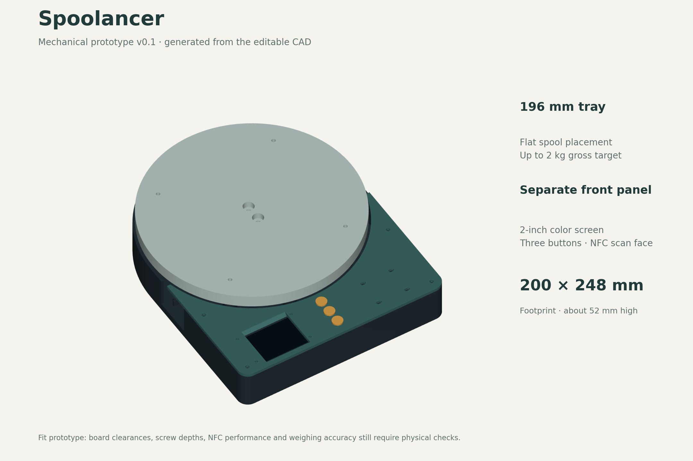

# Spoolancer

A standalone filament-spool scale built around an ESP32-S3, a 5 kg load cell, PN532 NFC reader/writer and a small color screen. Place a spool on the tray when needed; the device does not hold the spool during printing.

The planned workflow is to identify a spool, measure its weight, calculate remaining filament from a known empty-spool weight, and optionally send the accepted measurement to Spoolman. Original Bambu and Snapmaker tags are read-only in the first version; writable inventory tags belong to the scale. The Snapmaker U1 retains stock firmware.

**Current state: mechanical fit prototype and electronics plan. Firmware and physical validation are still pending.** The project is intended for an open-source release; no public release has been made here.

- [CAD files, printable STLs and fit samples](cad/README.md)
- [Assembly guide and mounting hardware](docs/ASSEMBLY.md)
- [Exploded view](cad/previews/exploded.png) and [load-path diagram](cad/previews/load-path.png)
- [Parts to buy](SHOPPING.md)
- [Proposed wiring](WIRING.md)
- [Firmware and Spoolman plan](PLAN.md)
- [Mechanical dimensions and their sources](docs/MECHANICAL-SOURCES.md)

The enclosure uses three main printed pieces, with a 200 × 248 mm footprint, a 196 mm tray and approximately 52 mm total height including feet. Start with the small fit samples before printing the full enclosure. The CAD source and parameters are included so other builders can adapt the mounts to their own board revisions.
