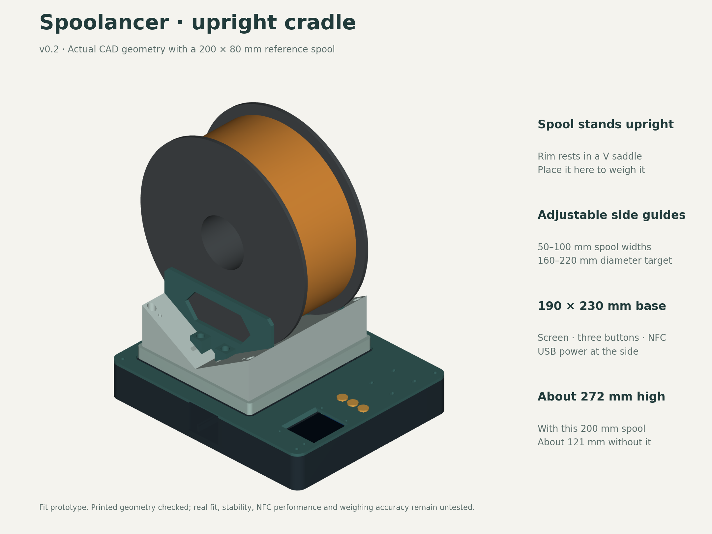

# Spoolancer

A standalone filament-spool scale built around an ESP32-S3, a 5 kg load cell, PN532 NFC reader/writer and a small color screen. Stand a spool upright in the V-shaped saddle when needed. The current design is intended for spool widths from 50 to 100 mm with adjustable side guides and uses no axle or bearings. It is for occasional weighing, not feeding filament during printing.

The planned workflow is to identify a spool, measure its weight, calculate remaining filament from a known empty-spool weight, and optionally send the accepted measurement to Spoolman. Original Bambu and Snapmaker tags are read-only in the first version; writable inventory tags belong to the scale. The Snapmaker U1 retains stock firmware.

**Current design: v0.2 upright-spool prototype, with a maximum spool width of 100 mm. Firmware and physical validation are still pending.** The project is intended for an open-source release; no public release has been made here.

- [CAD files, printable STLs and fit samples](cad/README.md)
- [Assembly guide and mounting hardware](docs/ASSEMBLY.md)
- [Exploded view](cad/previews/exploded.png) and [load-path diagram](cad/previews/load-path.png)
- [Parts to buy](SHOPPING.md)
- [Proposed wiring](WIRING.md)
- [Firmware and Spoolman plan](PLAN.md)
- [Mechanical dimensions and their sources](docs/MECHANICAL-SOURCES.md)

The design uses six main printed pieces: base, top cover, moving carrier, V-shaped saddle and two identical side guides. Its nominal base footprint is 190 × 230 mm. The upright spool extends above and behind that footprint; allow about 272 mm height and 245 mm depth for the modeled 200 mm spool, including the specified feet. Start with the small fit samples before printing the full assembly. CAD parameters are included so builders can adapt the mounts to their actual boards.

The earlier flat-spool design is [archived and superseded](archive/v0.1-flat/SUPERSEDED.md). Use the current v0.2 files for this upright-spool build.
