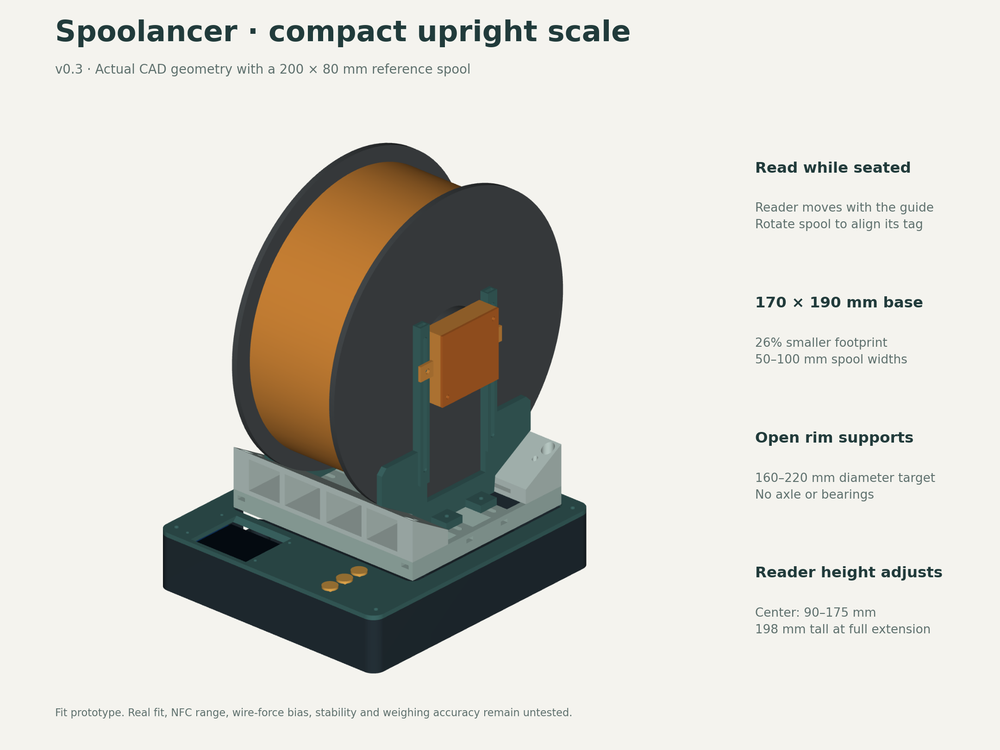
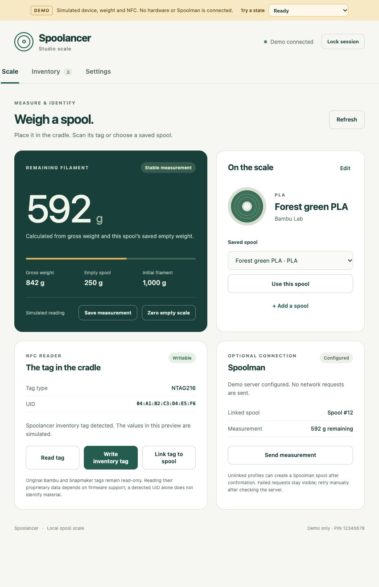

# Spoolancer

A standalone upright filament-spool scale using an ESP32-S3 N16R8, a 5 kg load cell, HX711, PN532 and a 2-inch color display. Place a spool on it when needed, identify it, measure remaining filament and optionally send the measurement to Spoolman. The ESP32 hosts its own web interface and stores local inventory without requiring a server.

**Current revision: v0.3 compact prototype.** CAD exports, a working browser demonstration and initial device firmware are included. Physical fit, weighing accuracy, seated NFC operation and live Spoolman integration have not been tested. The project is intended for an open-source release; a license and public release are still pending.



The base is **170 × 190 mm**, 26% less footprint area than v0.2. Two hollow rim rails and an open carrier replace the large saddle. The adjustable guides cover a proposed **50–100 mm spool-width range**. The PN532 sits in a height-adjustable side pod, allowing the tag to stay on the seated spool. Rotate the spool to align the tag and release it before weighing. This is an occasional-weighing tool, with no axle or bearings.

The reference 200 mm spool makes the loaded assembly about **170 × 215 × 257 mm**, including the nominal feet. The empty device is taller than v0.2 because of the reader mast: about 185–200 mm depending on reader height. The [material comparison](analysis/material-comparison/README.md) estimates **422 g of PETG versus 618 g for v0.2**, about **32% less**, using the same slicer settings. These are estimates, not measured print weights.

## Start here

- [Parts to buy](SHOPPING.md) and [wiring](WIRING.md)
- [CAD, printable STLs and five fit samples](cad/README.md)
- [Assembly guide and revised fasteners](docs/ASSEMBLY.md)
- [Reader detail](cad/previews/nfc-detail.png), [exploded view](cad/previews/exploded.png) and [load path](cad/previews/load-path.png)
- [Local web interface guide](docs/WEB-INTERFACE.md)
- [Firmware build and installation](firmware/README.md)
- [Implementation evidence and remaining checks](docs/STATUS.md)
- [Design plan](PLAN.md) and [mechanical sources](docs/MECHANICAL-SOURCES.md)

## Local interface

The interface supports live weight, spool profiles, brand, material, color, empty-spool weight, initial filament weight, NFC read/write, calibration, Wi-Fi setup and optional Spoolman create/link/sync. Stable readings are accepted explicitly; a missing empty-spool weight never becomes guessed remaining filament.



Preview it on a computer without hardware:

```sh
python3 -m http.server 8873 --bind 127.0.0.1 --directory web
```

Open <http://127.0.0.1:8873/?demo=1> and pair with **12345678**. The amber banner identifies simulated data; this preview never contacts a scale or Spoolman. On the ESP32, the same interface calls real device endpoints and never falls back to demonstration data.

## Tag and server compatibility

- Writable **NTAG216** inventory tags use Spoolancer schema 1. Writing requires a confirmed UID and matching read-back. OpenSpool interoperability remains deferred.
- Original **Bambu Lab and Snapmaker** tags are read-only, UID-only in this initial firmware. Link a UID to a manually entered profile; proprietary material decoding is still pending. Inventory tags do not create authenticated profiles for stock printers. Snapmaker U1 keeps its stock firmware.
- **Spoolman is optional.** The first implementation uses HTTP with a numeric local IPv4 address. It can create vendor/filament/spool records or link an existing spool, then update absolute remaining weight. Existing remote filament metadata is not automatically edited. Retry is manual; uncertain create outcomes require reconciliation.

Print fit samples before the full assembly. Calibrate with the complete moving cradle, reader and flexible wiring installed. A cable touching or pulling the carrier can change its reading; the [assembly checks](docs/ASSEMBLY.md) cover this.

Earlier versions are preserved in [v0.2 upright](archive/v0.2-upright/SUPERSEDED.md) and [v0.1 flat](archive/v0.1-flat/SUPERSEDED.md). Use current v0.3 exports for the compact build.
