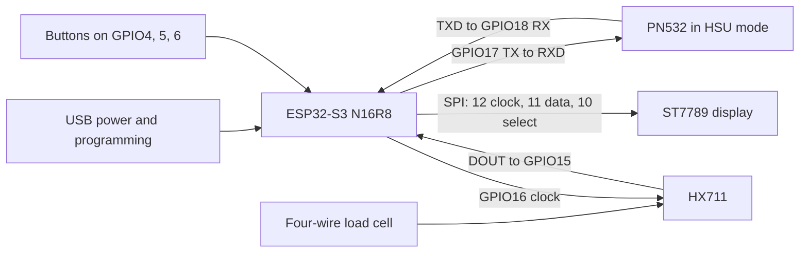

# Spoolancer prototype wiring

Proposed wiring, 26 October 2026. Based on the supplied component images and the selected modules in [SHOPPING.md](SHOPPING.md). The GPIO allocation is ready for the prototype; actual hardware operation still needs verification.

The [ESP32 image](docs/reference/esp32-s3-n16r8-v6.png) shows an ESP32-S3-N16R8 module, 44 header positions, V6.0.0 on the back, and separate COM and USB connectors. Use the printed GPIO labels rather than counting header positions. Its layout resembles DevKitC-style boards, but this is not evidence that it is an official Espressif or YD board. N16R8 denotes the advertised 16 MB flash and 8 MB PSRAM configuration; verify detected memory during firmware bring-up.

The [PN532 image](docs/reference/pn532-v3-listing.png) shows a red NFC MODULE V3 with Elechouse markings, a two-position interface switch and a shared four-pin UART/I2C header. It matches the Elechouse V3 design family. The photo alone cannot verify an exact clone's circuit.

**Connect the PN532 over UART/HSU.** This requires four wires and leaves the display's SPI bus independent.

| PN532 pin, using its UART labels | ESP32 connection | Direction |
| --- | --- | --- |
| VCC | 3V3 | Power |
| GND | GND | Common ground |
| TXD | GPIO18 | Reader transmits to ESP32 RX |
| RXD | GPIO17 | ESP32 TX transmits to reader |

Set switch 1 OFF and switch 2 OFF with power disconnected. Read the numbered switches and their ON mark; do not infer settings from left/right orientation in a photograph. The UART labels are on the reverse side of the shared header. Start the selected ESP32 hardware UART at 115200 baud, 8 data bits, no parity and one stop bit, with RX18 and TX17 explicitly configured. Avoid the development board's header pins marked TX and RX, which are UART0 and belong to the programming connection.

The [Elechouse V3 manual](https://www.elechouse.com/elechouse/images/product/PN532_module_V3/PN532_%20Manual_V3.pdf) specifies a 3.3–5 V module supply and the switch table below. The [NXP application note](https://www.nxp.com/docs/en/nxp/application-notes/AN133910.pdf) documents 115200 as the default HSU baud rate. Use 3.3 V supply for the initial ESP32 prototype. If a particular module is unreliable at that voltage, check its actual regulator and output levels before changing its supply to 5 V.

| Interface | Switch 1 | Switch 2 |
| --- | --- | --- |
| HSU, selected for this build | OFF | OFF |
| I2C | ON | OFF |
| SPI | OFF | ON |

**Reserve these pins for the scale, display and controls.** All numbers are GPIO labels, not physical pin numbers.

| Peripheral signal | ESP32 GPIO | Notes |
| --- | --- | --- |
| HX711 DOUT / DT | 15 | Input from amplifier |
| HX711 SCK / CLK | 16 | Output to amplifier |
| ST7789 SCK / CLK | 12 | SPI clock |
| ST7789 DIN / MOSI | 11 | SPI data from ESP32; a display pin called SDA may mean SPI data on this module |
| ST7789 CS | 10 | Display select |
| ST7789 DC | 9 | Command/data selection |
| ST7789 RST / RES | 8 | Display reset; separate from the ESP32 reset pin |
| Previous button | 4 | Button to GND; internal pull-up |
| Next button | 5 | Button to GND; internal pull-up |
| Select button | 6 | Button to GND; internal pull-up |

The selected screen is the Waveshare 2inch LCD Module, SKU 17344, a non-touch 240 × 320 ST7789 SPI module. Connect VCC to 3V3, GND to GND, and use the signal table above. Connect BL to 3V3 for constant backlight. Its [schematic](https://www.waveshare.net/w/upload/e/ee/2inch_LCD_Module_SchDoc.pdf) includes an onboard transistor, so BL is a control connection. It does not need MISO for the intended write-only operation. Use the included PH2.0 eight-wire cable, matching the printed signal labels rather than assuming wire colors.

The selected HX711 is [Bit Maker code 0679](https://www.bitmaker.com.br/m-dulo-conversor-hx711-adc-24-bits-para-sensor-de-peso), listed for 3–5 V supply. Connect VCC to 3V3, GND to common GND, DT to GPIO15 and SCK to GPIO16. This is a single-supply board selection; do not use a different breakout's separate VCC/VDD wiring without checking its schematic.

For the selected [Bit Maker code 1381 cell](https://www.bitmaker.com.br/sensor-de-peso-c-lula-de-carga-5kg), the seller specifies red to HX711 E+, black to E−, green to A+ and white to A−. Verify the received part's labeling; other cells can use different colors. Its body is 80 × 12.7 × 12.7 mm and its mounts require two M4 and two M5 screws, with length determined by the enclosure design.

**Keep the reserved ESP32 pins free.** GPIO35–37 serve octal PSRAM on this memory configuration. GPIO19–20 serve native USB. GPIO0, 3, 45 and 46 affect boot configuration. Preserve GPIO43–44 for UART0 and leave GPIO38 and GPIO48 unused to avoid possible onboard RGB LED mappings. The assignment also leaves the external JTAG pins unused. These choices follow [Espressif's memory restriction](https://docs.espressif.com/projects/esp-dev-kits/en/latest/esp32s3/esp32-s3-devkitc-1/user_guide_v1.1.html) and [ESP32-S3 pin documentation](https://documentation.espressif.com/esp32_s3_datasheet_en.pdf); the official development board's physical layout is not being substituted for the supplied image.

Power the initial prototype through one USB cable using the board's COM connector for programming. Keep the board's power-selection solder pads unchanged. All modules share GND. Start with each peripheral separately, then check the 3.3 V rail and reliable boot with the screen backlight and NFC field active together. The photo does not establish available regulator current for the complete assembly.

First electrical checks are board boot and detected memory, PN532 firmware identification, repeatable reads of the bundled test tag, display operation, and changing raw load-cell values. Then combine the peripherals and calibrate the finished mechanism. Identify the bundled card/key fob before using it in write tests; its appearance does not prove it is an NTAG216.

## v0.3 side reader cable

The electrical pin assignment stays the same, but the PN532 now travels with the adjustable side guide. Its antenna faces the spool flange. Route the four HSU wires through the pod's cable exit and down the moving guide. Use flexible stranded wire with a broad slack service loop between the moving assembly and the fixed base. Add strain relief at both ends, without pulling the loop taut. The loop must clear the rim rails, carrier opening and stops at every supported width and reader height.

The reader, its holder and the moving part of its cable count as scale dead load. Zero the complete empty assembly after changing guide or reader position. Compare zero and known-mass repeatability with the reader at both height extremes and guide widths of 50 and 100 mm. If repositioning or touching the cable changes the settled reading, revise its routing before calibrating. Firmware cannot reliably correct an unknown mechanical pull from a stiff cable.

Reading and writing happen with the spool seated and the tag aligned. Release the spool and wait for a new stable measurement after adjusting it or running a write. Original vendor tags remain read-only.
