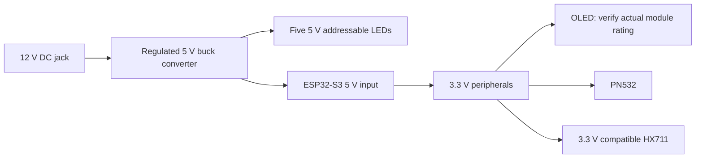

# 12 V input for the LED and OLED variants

Use the [complete wiring guide](../WIRING.md) for every connection, the [power/signal drawing](wiring/spoolancer-wiring-overview.svg) and the [LED buffer pinout](wiring/spoolancer-led-buffer.svg). The guide uses a removable 5V/GND header connection, **J1**, and a removable GPIO6 signal connection, **J2**.

The `headless-led` and `oled-led` v0.8 cases have no external USB cutouts. A top tool hole in the cradle provides provisional access to onboard BOOT after removing the spool. To reach the USB ports, remove the two moving-end M4 screws, support the loose load-cell spacer, disconnect the reader lead and lift the cradle. The fixed-end M5 screws stay installed.

**12 V is the input to a buck converter, never the supply to the ESP32 or the 5 V LED strip.** Use a regulated fixed 5 V converter rated for at least 2 A continuous at 12 V input. The owner will glue an insulated converter assembly to a fixed enclosure wall; no dedicated converter mount is required. Its actual dimensions, heat dissipation and wiring must clear the moving assembly. A converter and jack have not yet been physically verified in this enclosure.

All grounds join. Check jack polarity with a meter; a centre-positive supply is the intended convention. The jack's switched terminal, if present, is not automatically a ground terminal. Verify the converter outputs 5.0 V before connecting electronics. An adjustable converter must be set and secured before use.

## Power connection and programming

Use one controller supply path at a time. The [Espressif development-board guide](https://docs.espressif.com/projects/esp-dev-kits/en/latest/esp32s3/esp32-s3-devkitc-1/user_guide_v1.1.html#power-supply-options) treats USB, 5 V header and 3.3 V header supplies as alternatives. The owned V6.0.0 clone's protection circuit is unverified, so do not assume it isolates two sources.

The wiring guide uses the board's header marked **5V / 5Vin and GND**, with a removable two-wire connector, J1. Before attaching a computer USB cable, disconnect the 12 V supply **and J1**, then disconnect **J2**, the GPIO6 lead into the LED buffer. Removing only the 12 V input can still leave a path for USB to feed backward into the converter; leaving GPIO6 attached can drive the unpowered buffer. Keep the buffer and strip off during USB-only programming. Remove USB before reconnecting J1/J2 and restoring DC power.

An internal USB-C power plug into COM is an alternative to the header connection if the actual plug fits. Disconnect it and replace it with the computer's data cable when programming, and still disconnect GPIO6 from the unpowered buffer. The v0.8 model does not include a qualified USB plug or bend envelope; check the complete plug and wire clearance in the actual enclosure. Do not use the USB plug and header as simultaneous supply paths.

LED power branches directly from the converter's 5 V output. It does not pass through the ESP32's 3.3 V regulator. Keep LED supply/return wires short and away from the load-cell leads and HX711 input. Brightness limiting reduces normal consumption but does not replace a correctly sized supply.

## LED signal and protection

For the provisional WS2812B-compatible firmware profile:

| Connection | Signal |
| --- | --- |
| ESP32 GPIO6 | Data, through a 3.3 V-to-5 V logic buffer |
| Buffer output | Through a 330–470 ohm resistor near the first LED's DIN |
| Converter 5 V / GND | Strip 5 V / GND, common with ESP32 ground |
| Strip DOUT | Leave unconnected after the fifth LED |

Use a suitable fast non-inverting buffer such as 74AHCT125, powered from 5 V, with its enable wired correctly. The full guide specifies a 100 nF bypass capacitor and 10 kΩ input pull-down so the enabled input stays defined during ESP32 reset. A preassembled buffer module can avoid a perfboard; check which parts it already includes. Do not substitute a generic slow I²C level-shifter module without verifying its suitability for the strip protocol. Use a 330 Ω DIN resistor and a 1000 µF capacitor rated at least 10 V across the strip's **5 V** supply, positive to 5 V and negative to GND. These choices fall within [Adafruit's NeoPixel guidance](https://learn.adafruit.com/adafruit-neopixel-uberguide/best-practices); the actual strip model remains to be identified. See the [exact 14-pin buffer wiring](../WIRING.md#exact-14-pin-74ahct125-wiring).

The OLED firmware uses SDA on GPIO4 and SCL on GPIO5. Confirm the module's 3.3 V operation and ensure I²C pull-ups do not raise either signal above 3.3 V. A 0.96-inch size does not establish the controller or supply circuit.

## Mechanical and electrical checks

Drill with all electronics removed. Check both sides of the chosen wall for the jack's complete body, nut and wire bend radius; do not cut the load-cell supports, load-cell mounts or stop posts. The jack opening has deliberately not been generated in CAD.

Before permanent assembly, verify converter output under the combined Wi-Fi, NFC, OLED and LED load, check temperatures, and compare repeatable scale readings with LEDs/display on and off. CAD clearance and a successful USB firmware boot do not verify the 12 V power path or weighing accuracy.
