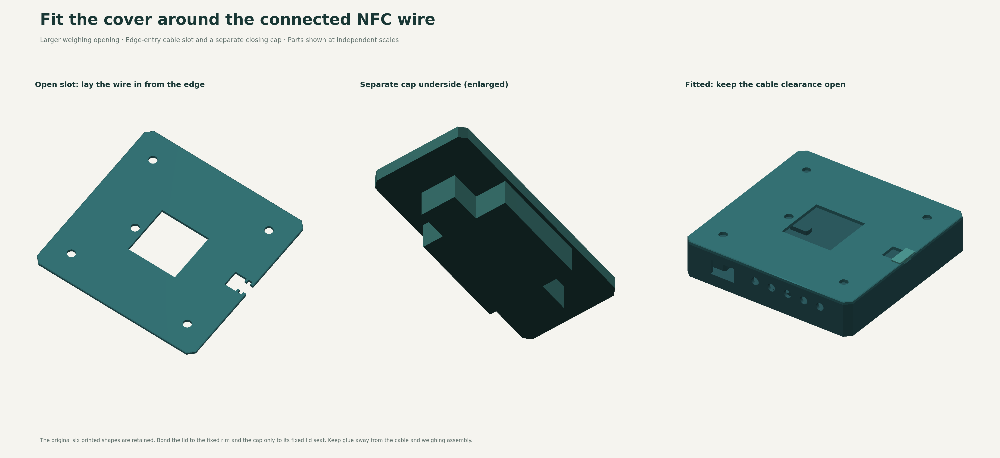

# Add the top cover without disconnecting the NFC cable

Print **one `base_top_cover` and one `nfc_cable_gate`** for an existing v0.8 OLED + LED or LED-only base. The six original STL files are unchanged; no base reprint or extra screws are required. The complete model has eight printed parts and still uses twelve screws.

The central opening is now **50 × 50 mm**. The NFC opening has a slot extending to the right edge, so an already-soldered lead can enter sideways. A small keyed cap then closes that outer slot, leaving the inner cable opening clear. **No desoldering or connector threading is needed for this addition.**

| Part | Print file | Editable solid |
|---|---|---|
| Top cover | [STL](../cad/variants/oled-led/exports/base_top_cover.stl) | [STEP](../cad/variants/oled-led/exports/base_top_cover.step) |
| NFC cable cap | [STL](../cad/variants/oled-led/exports/nfc_cable_gate.stl) | [STEP](../cad/variants/oled-led/exports/nfc_cable_gate.step) |

[Full FreeCAD assembly](../cad/variants/oled-led/exports/spoolancer-v0.8.1-oled-led.FCStd) · [Exploded view](../cad/variants/oled-led/previews/exploded.png)

## Print

The main plate remains **170 × 170 × 3 mm**, with clipped corners and a 0.6 mm upper perimeter chamfer. Print the exported STL at 100%, flat underside on the bed. The small cap prints **broad flange down, locating tongue upward**; its exported orientation is already set. Both LED and OLED versions use these same two shapes.

Use the [print guide](PRINTING.md) and [recorded PETG slice evidence](../analysis/printability-v0.8/README.md). Together, these two parts estimate **73.01 g on P1S** or **71.82 g on U1**, with no generated supports under the recorded profiles. Slicer estimates are not physical print results. Test the small cap's fit before gluing; remove first-layer expansion rather than forcing it into the slot.

## Openings and clearance

Coordinates below use the assembled CAD origin at the centre of the base. The OLED/front wall is toward negative Y; the NFC tower and cable entry are on positive X.

| Opening | Size and position | Purpose |
|---|---|---|
| Moving cell spacer | 50 × 50 mm; X −25…25, Y −27.5…22.5 | Larger clearance around the spacer; both moving-end M4 screws remain accessible through the cradle |
| Four stop screws | Ø8 mm; X ±62, Y ±60 | Clears the existing heads and preserves the cradle's driver paths |
| BOOT probe | Ø8 mm; X −33, Y −6 | Aligns below the existing Ø6 cradle hole; confirm actual button placement |
| NFC inner bay | X 64…76, Y −8…8 before the cap flange overlap | Leaves space around the flexible lead into the fixed base |
| NFC side entry | 10 mm wide to the right edge; keyed pocket widens to 16 mm | Allows the lead to enter sideways with both soldered ends intact |

The cap has **0.3 mm nominal fit clearance** around its keyed tongue. Its wider shoulders locate it, and its flange rests on the fixed cover. The inner flange edge is at X=75.5, leaving an **11.5 × 16 mm** clear rectangular cable bay below the inner opening. The cap does not grip the wire. Small adhesive spots on the stationary seating surfaces provide retention; this is **not a snap latch or cable strain relief**.

The cover sits on the **stationary base rim at Z=32 mm**. Its top is Z=35 mm, leaving **5.5 mm** below the unloaded cradle, or **4.5 mm** after the modeled 1 mm downward travel. The cap's top is Z=36.6 mm, leaving **3.9 mm** below the cradle, or **2.9 mm** after that travel. Neither piece may carry the cradle or touch the moving spacer. The initial stop setting is not verified overload protection.

The reference OLED has only **0.35 mm clearance below the cover**. Check real display placement, solder joints, converter height, wires and print warping before bonding. This addition does not change the load-cell mount: measure your actual 20 kg cell and its existing mount independently.

## Fit an already assembled unit

1. Remove the spool and disconnect all power. Remove the two moving-end M4 screws and lift the cradle/tower while supporting the separate spacer. Leave the fixed-end M5 screws installed. Keep the cradle beside the base and support it so the soldered NFC lead stays slack; open the removable reader rear cover if needed to free its slack loop.
2. Leave the small cap out. Hold the unglued cover above the base rim and all stop heads. Bring its open side slot around the existing NFC lead and move the lead into the inner cable bay, then lower the cover onto the rim. The fixed base wall does not have a side slot: do this while the cover is raised, not by forcing the lead sideways through the wall. Neither soldered end needs to pass through a hole.
3. Rest the cover on the stationary base rim without glue. Check it lies flat and touches only the rim. Check OLED, converter and wire clearance; never force the plate against a component.
4. Lower the cap's keyed tongue vertically into its seat, with its wide flange uppermost. The lead stays in the inner bay, clear of the cap. Check the cap seats fully and leaves the lead free; do not trap insulation under the tongue or flange.
5. Refit the spacer and cradle. Check the central opening, all four stop paths, BOOT access and cable slack throughout reader travel. Test the electronics and compare zero return and known-weight readings with and without the dry-fitted cover/cap. A change suggests contact or wire tension that needs correction.
6. Disconnect power again and lift the cradle/spacer for controlled glue application, supporting it without pulling the cable. Use an adhesive compatible with your filament, following its surface preparation and full-cure instructions. Apply a small amount **only to the fixed base rim**. Seat the cover without force.
7. With the lead in the inner bay, seat the cap and retain its flange with small adhesive spots **only where it bears on the stationary cover**. Keep glue away from the cable, slot interior, load cell and all moving parts. Let both joints fully cure before reassembly and use. Repeat the clearance, zero-return and calibration checks.

The cover is a permanent glued closure. Removing the cradle leaves it in place; accessing the electronics later requires releasing the adhesive bond. To remove the lid around the still-soldered cable, also release and lift the small cap, then move the wire sideways out of the edge slot. Keep the NFC rear cover removable with its existing two screws. Do not pry against the load cell or boards.

## Verification limits

[Geometry checks](../cad/variants/oled-led/exports/validation.json) and [reopened export checks](../cad/variants/oled-led/exports/export-verification.json) cover the final solids, moving clearances, side-entry cable path and cap placement. [Compatibility records](../cad/variants/oled-led/exports/v0.8-compatibility.json) compare the original six STLs with v0.8.

Physical fit, adhesive retention, thermal conditions inside the closed base and weighing accuracy with the cover installed remain untested. Leave both new pieces unglued until the actual assembled unit passes its checks.
