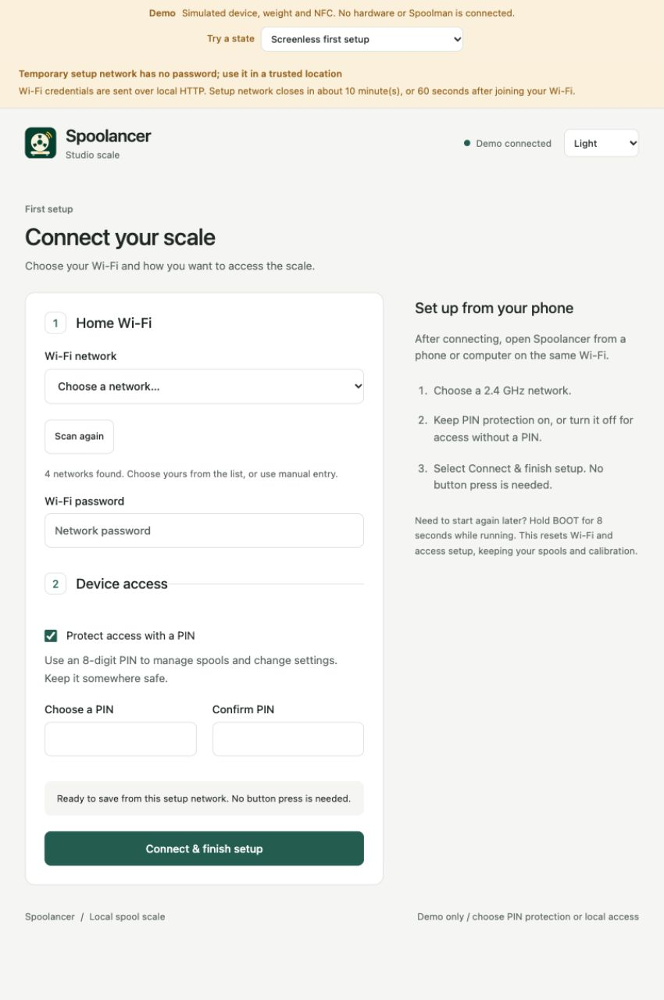
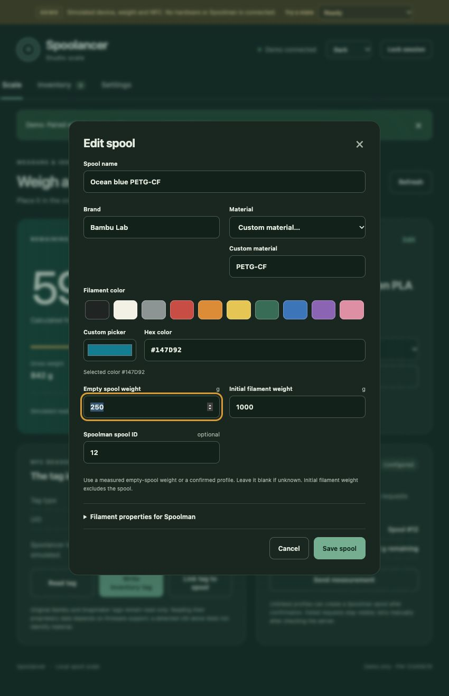

# Spoolancer interfaces

Every build serves the full local web interface from its ESP32. A phone or computer on the device's network can manage spools without a cloud account. The ESP-8048S043C-I variant also has native touchscreen controls; it does not run a desktop browser or embed the web demonstration.

| Action | Browser | Native touchscreen |
| --- | --- | --- |
| Live weight, active spool and status | Yes | Yes |
| Choose an existing spool | Saved-spool selector | Previous / Next |
| Read/write an inventory tag | UID/profile preview and confirmation | Native read/write controls and confirmation |
| Save measurement, sync, zero | Yes | Yes; conditions rechecked before acting |
| Name, brand, material, color, tare and starting-weight editing | Full editor | Use the browser |
| Scale calibration | Settings → Calibration | Use the browser |
| Wi-Fi and Spoolman setup | First-run wizard / Settings | Use the browser |
| Appearance | Light / Dark / System | Light / Dark, stored separately on device |

Native touchscreen operation is implemented but physically untested. Browser checks and a successful firmware build cannot establish display/touch behavior on the purchased board.

## First setup for screenless and touchscreen builds

1. Join the temporary `Spoolancer-xxxx` Wi-Fi and open `http://192.168.4.1`. On an unconfigured headless, OLED or touchscreen build, the first page is **Connect your scale**.
2. Select your 2.4 GHz Wi-Fi from the list and enter its password. Use **Scan again** to refresh, or **Hidden or other network** to enter an exact network name. Open networks are explicitly marked.
3. Leave **Protect access with a PIN** enabled to choose and confirm eight digits. Turn it off if you want local access without entering a PIN; anyone on the same network can then manage the scale.
4. Click **Connect & finish setup**. No physical button press is required. The device saves Wi-Fi and the access choice together, then reports whether it has actually connected.
5. After connection, join the same normal Wi-Fi on your phone and open the displayed LAN address. You can also try `http://spoolancer.local` where mDNS is supported. PIN-protected sessions need pairing after reload or expiry; no-PIN sessions open automatically.
6. The setup network closes after **10 minutes**, or **60 seconds after LAN connection**. Check incorrect credentials in Settings while it remains available. Hold **BOOT for 8 seconds while running** to reset Wi-Fi and access setup; inventory, calibration and Spoolman settings/links are kept.

Upgrading a device with an existing PIN keeps its protection, even if it has no saved Wi-Fi. Pair and use Settings, or physically reset setup to use the new wizard. **Settings → Wi-Fi** uses the same network selector. A blank password keeps the saved password only for the unchanged network; selecting a different secured network requires its password.

These builds use onboard BOOT on GPIO0 **while firmware is running**. RST only restarts the board. Holding BOOT during power-up or RST enters the bootloader instead; release BOOT and tap RST to run normally. No separate setup switch or perfboard is needed. The legacy ST7789 build retains its displayed/Serial PIN and password-protected setup AP; follow its [firmware instructions](../firmware/README.md#screen-version-first-use).

**Temporary setup network has no password; use it in a trusted location.** PIN and Wi-Fi credentials use local HTTP and can be observed by someone nearby. Initial setup is accepted only while unconfigured, through the temporary setup access point, within its time limit. These restrictions do not encrypt traffic.

## Calibrate the scale

Open **Settings → Calibration**, or follow the calibration link from Scale. The old `#calibration` address redirects into Settings. Pair with the device before making changes.

1. Remove the spool and any other load. Leave the complete cradle, reader and wiring installed. When sensor readings are fresh and stable, click **Zero empty scale** and confirm. This step must succeed in the current browser session before calibration is enabled.
2. Place a known reference weight on the cradle. Enter its actual mass from **100 to 2,000 g**, then click **Save calibration** and confirm. Keep it still while the device checks and saves the calibration.
3. Remove the reference and check that the live gross reading returns near zero. Verify with another known mass and repeated placements before relying on measurements.

A nominal 1 kg filament spool is not a known calibration mass. For a compatible 20 kg cell, enter the reference weight, not 20,000 g; no capacity setting is required. The application's gross-spool limit remains 2 kg. Use **Start again** after a cell or mounting change; this restarts the browser steps without erasing the device's stored calibration.

The page shows device connectivity, sensor freshness, saved-calibration status and live gross weight. Calibration uses the device's reference-specific stability check; the existing calibration's ordinary stability flag does not block replacement-cell calibration. The device saves zero and the conversion factor in NVS. Rejected factor validation preserves the previous factor, and a storage failure is reported instead of claiming success. A saved calibration is not proof of physical accuracy.

After a browser reload or session lock, zero the empty cradle again before another calibration. Offline and stale sensor states disable changes. After saving, wait for new sensor samples before checking the reading. In the desktop demo, all of these actions are simulated and last only until reload.

## Daily use

1. Place the spool upright in the cradle. Adjust the side reader to face its tag; rotate the seated spool if needed. Release it and wait for a stable reading.
2. Read its inventory tag or choose its saved record. Add a new spool with its name, brand, material, color and initial filament weight.
3. Enter the known empty-spool weight. For an explicitly new, full spool, the editor can estimate this as stable gross weight minus the declared initial filament weight (default 1,000 g). A nominal filament label is an assumption: this estimate inherits its error. Do not use this method for a partly used spool.
4. Save a stable measurement. Remaining filament is gross weight minus the saved empty-spool weight. Without Spoolman, the inventory is local. With Spoolman configured, Inventory lists the server's records and identifies stale cached results when the server is unavailable. Check uncertain remote writes before retrying.
5. For a writable inventory tag, review the UID and profile before confirming. Keep the tag aligned until read-back completes, then wait for weighing to settle again.

Zero the complete empty cradle, including its reader/cables. This differs from the empty-spool weight stored in a profile. Material and brand come from a profile or supported tag metadata; weight alone cannot identify them.

## Color, material and appearance

The spool editor has ten named color swatches, a custom color picker and an editable hex field. Three-digit hex expands to six digits. Common materials are available in a selector; **Custom material** preserves values such as PETG-CF. Color is a stored profile value, not inferred from a camera or spool appearance.

The browser's **Appearance** control selects Light, Dark or System. System follows the operating system's theme. Only this preference is saved in browser storage. PIN, session token and Wi-Fi password are not persisted there. Native touchscreen light/dark preference is independent.

The browser layout adapts to phones and 800 × 480 browser windows, with scrolling forms. That browser viewport behavior is separate from the native 800 × 480 firmware display.

## Local access and persistence

Browser sessions gate private inventory/configuration and mutations. PIN-protected devices require pairing; explicit no-PIN mode obtains a session automatically from the device’s trusted local address. The session token stays in tab memory. Stored Wi-Fi passwords are never returned by the API. The interface distinguishes stale, uncalibrated, unstable, disconnected and unsupported-tag states; accepted measurements require an explicit save.

Calibration, local-only records, tag bindings and the remote-operation journal live on the device. A configured Spoolman server owns the inventory; an ESP cache is not a second authoritative inventory. Assets and private storage use separate flash partitions: normal asset upload preserves private data, while a full erase or changed partition layout can erase it. See the [firmware storage/recovery guide](../firmware/README.md).

## Spoolman and NFC limits

In **Settings → Connections**, use **Find on network** after connecting the ESP32 to Wi-Fi. The scale checks port 7912 in its own /24 address block, restricted to its actual subnet, and optional mDNS advertisements. Search is bounded to 254 addresses and 45 seconds. It verifies a candidate's Spoolman API before listing it. Other ports, subnets, isolated Wi-Fi clients or blocked discovery can require manual entry.

Select a result or enter an HTTP URL with a numeric local IPv4 host, such as `http://192.168.1.50:7912`. Use **Save server**, then **Test saved server**. Saving the server leaves unsaved Wi-Fi/device fields alone. Discovery never selects or saves a server automatically. DNS names in manual URLs, HTTPS and server authentication are not implemented.

With a server configured, Inventory lists up to 200 active Spoolman spools. Material, color and weight metadata come from that server. Edit an existing profile in Spoolman; Spoolancer can bind an inventory tag and send a measured remaining weight. Archived or removed remote records disappear after refresh. Offline data is labeled as cached, and a failed initial fetch is shown as unavailable, not as an empty inventory. Unfinished registrations appear separately for recovery.

Saving a new spool in remote mode creates its server record after explicit submission. Density and diameter are needed for new filament records. Existing entries receive absolute remaining-weight updates, verified against the response. Reconcile an uncertain create with its existing server ID before retrying. Changing servers is blocked while links or unresolved operations need reconciliation. There is no automatic background write queue.

In **Inventory**, each spool has **Add RFID / Change RFID** and **Remove** actions. RFID linking scans and confirms the chosen profile and the currently present tag, rejects a tag already owned by another profile, and saves only the local binding. The spool does not need to be selected on Scale first. Protected or unreadable tag contents do not prevent linking a readable identifier.

Remove deletes a local profile and its saved measurements from the scale. For a linked Spoolman spool it instead archives the server record, verifies that result and removes the local active entry; server history is retained. Each action names its target and destination before confirmation. An uncertain archive keeps its recovery record, including after the server hides the archived spool: use **Check & finish archive** under unfinished actions. Do not register it again to recover.

If that server record was subsequently deleted elsewhere, recovery verifies the server and actual absence before clearing its pending local entry. The result explicitly says it was already absent; deleted server history cannot be restored by this action. Network errors or incomplete checks keep the recovery record.

If a spool was archived or removed directly in Spoolman, a retained RFID association appears separately with **Unlink RFID**. Confirming removes only that scale's saved association and frees the tag for another spool; it does not write the tag or modify the server record. A clean local draft can be discarded. An unresolved server creation journal cannot be discarded until its outcome is reconciled.

NTAG213/215/216 writes use Spoolancer schema 1 in an `application/vnd.spoolancer+json` NDEF record, subject to supported protection/layout and complete-record capacity checks. NTAG213 normally cannot fit the current complete profile; NTAG216 remains the recommended writable sticker. NFC-A, NFC-B, FeliCa and Jewel identifiers can be linked without writing memory; Type 5 is outside the PN532's support. See the [tag compatibility matrix](NFC-TAGS.md). OpenSpool compatibility is deferred. Original Bambu/Snapmaker tags remain identifier-only; custom inventory tags do not become authenticated stock-printer tags. Snapmaker U1 retains stock firmware.

The side reader requires the actual antenna and tag to align. Plastic/flange thickness, orientation and nearby metal affect range. Test the final enclosure and actual tags; no universal seated-read compatibility is established.

## Desktop demonstration

Serve `web/` locally and open `http://127.0.0.1:8873/?demo=1`; normal demo PIN is **12345678**. The permanent amber banner identifies simulated data. **Screenless first setup** offers network selection and optional PIN protection without a BOOT step. No demo action contacts hardware or Spoolman. Without the explicit query/local hostname, the page uses real device endpoints and never substitutes simulated readings.

See [web/README.md](../web/README.md) for preview commands and API details, and [firmware/README.md](../firmware/README.md) for build/install instructions. Browser tests, firmware compilation, hardware operation and live server integration remain separate checks.

## Hardware tests and five-LED indicator

Open **Settings → Hardware tests** after pairing. Test NFC rechecks PN532 communication and reads one tag identifier. Test scale checks fresh samples and reports whether calibration or stability needs attention; add/remove a known mass to observe response. Neither action writes a tag, saves a measurement or changes calibration.

Test LEDs starts a 12-second RGB/individual-pixel/fill-bar sequence. The countdown ends automatically and the normal status display resumes. Check the actual strip visually: software cannot verify emitted light or color order. Profiles without the five-pixel strip disable this control. Missing sensor samples, missing readers and no tag present have separate results.

Five completed cyan LEDs represent 100% of the declared initial filament. Each is 20%, using measured gross minus known empty-spool weight. The partial segment changes color at 5% steps: red, orange, yellow, green, then cyan when complete. Thus 85%, 90%, 95%, 96–99% and 100% make the fifth LED red, orange, yellow, green and cyan, while the first four stay cyan. At 10% or less the remaining segment pulses, and empty pulses red. Invalid measurements show a status animation instead of a weight bar.

The page includes a live five-segment preview and a legend for setup/connection, empty cradle, spool selection, settling/calibration, missing tare/sensor, invalid weight, NFC/save/Spoolman progress and success/failure. Browser themes apply to this panel too.
