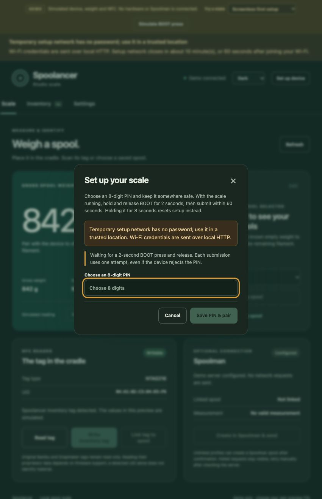
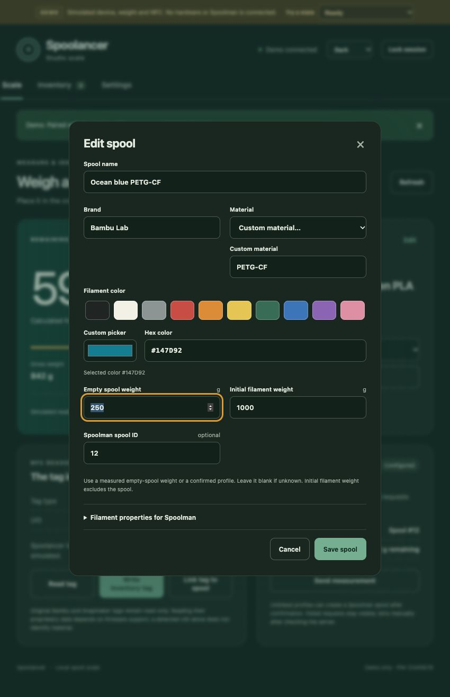

# Spoolancer interfaces

Every build serves the full local web interface from its ESP32. A phone or computer on the device's network can manage spools without a cloud account. The ESP-8048S043C-I variant also has native touchscreen controls; it does not run a desktop browser or embed the web demonstration.

| Action | Browser | Native touchscreen |
| --- | --- | --- |
| Live weight, active spool and status | Yes | Yes |
| Choose an existing spool | Saved-spool selector | Previous / Next |
| Read/write an inventory tag | UID/profile preview and confirmation | Native read/write controls and confirmation |
| Save measurement, sync, zero | Yes | Yes; conditions rechecked before acting |
| Name, brand, material, color, tare and starting-weight editing | Full editor | Use the browser |
| Calibration-reference entry, Wi-Fi and Spoolman setup | Full settings | Use the browser |
| Appearance | Light / Dark / System | Light / Dark, stored separately on device |

Native touchscreen operation is implemented but physically untested. Browser checks and a successful firmware build cannot establish display/touch behavior on the purchased board.

## First setup for screenless and touchscreen builds

1. Join the temporary `Spoolancer-xxxx` Wi-Fi and open `http://192.168.4.1` manually.
2. Choose an eight-digit PIN. While the scale is running, hold and release **BOOT for 2 seconds**, then submit within **60 seconds**. One press permits one attempt, including a rejected PIN. The browser disables enrollment until current device status confirms the physical arm.
3. Save Wi-Fi settings. While the setup page is still connected, note the LAN address shown under **Settings → Connection**. Reconnect your phone to the same normal Wi-Fi and open that address. You can also try `http://spoolancer.local` on networks that support mDNS; if it does not resolve, use the IP shown by the page or your router. Pair using your chosen PIN whenever the tab reloads or the session expires.
4. The setup network closes after **10 minutes**, or **60 seconds after LAN connection**, whichever is first. A configured device does not open it automatically when Wi-Fi fails. Hold **BOOT for 8 seconds while running** to reset Wi-Fi/pairing and reopen setup. Inventory, calibration and Spoolman settings/links are kept.

Both current builds use onboard BOOT on GPIO0 **while firmware is running**. RST only restarts the board. Holding BOOT during power-up or RST enters the bootloader instead; release BOOT and tap RST to run normally. No separate setup switch or perfboard is needed. The legacy ST7789 build retains its displayed/Serial PIN and password-protected setup AP; follow its [firmware instructions](../firmware/README.md#screen-version-first-use).

**Temporary setup network has no password; use it in a trusted location.** PIN and Wi-Fi credentials use local HTTP and can be observed by someone nearby. Physical arming and time limits restrict enrollment but do not encrypt traffic.

## Daily use

1. Place the spool upright in the cradle. Adjust the side reader to face its tag; rotate the seated spool if needed. Release it and wait for a stable reading.
2. Read its inventory tag or choose its saved record. Add a new spool in the browser with its name, brand, material, color, known empty-spool weight and initial filament weight.
3. Save a stable measurement locally. Remaining filament is gross weight minus the known empty-spool weight. Unknown empty weight leaves remaining filament unknown.
4. Create or link a Spoolman record and confirm sync when desired. Network errors leave local records available; retry manually after checking the server.
5. For a writable inventory tag, review the UID and profile before confirming. Keep the tag aligned until read-back completes, then wait for weighing to settle again.

Zero the complete empty cradle, including its reader/cables. This differs from the empty-spool weight stored in a profile. Material and brand come from a profile or supported tag metadata; weight alone cannot identify them.

## Color, material and appearance

The spool editor has ten named color swatches, a custom color picker and an editable hex field. Three-digit hex expands to six digits. Common materials are available in a selector; **Custom material** preserves values such as PETG-CF. Color is a stored profile value, not inferred from a camera or spool appearance.

The browser's **Appearance** control selects Light, Dark or System. System follows the operating system's theme. Only this preference is saved in browser storage. PIN, session token and Wi-Fi password are not persisted there. Native touchscreen light/dark preference is independent.

The browser layout adapts to phones and 800 × 480 browser windows, with scrolling forms. That browser viewport behavior is separate from the native 800 × 480 firmware display.

## Local access and persistence

Pairing gates private inventory/configuration and mutations. The session token stays in tab memory. Stored Wi-Fi passwords are never returned by the API. The interface distinguishes stale, uncalibrated, unstable, disconnected and unsupported-tag states; accepted measurements require an explicit save.

Records and calibration live on the device. Assets and inventory use separate flash partitions: normal asset upload preserves inventory, while a full erase or changed partition layout can erase it. See the [firmware storage/recovery guide](../firmware/README.md).

## Spoolman and NFC limits

Spoolman is optional. Use an HTTP URL with a numeric local IPv4 host, such as `http://192.168.1.50:7912`, on a trusted network. DNS names, HTTPS and server authentication are not implemented. Density and diameter are needed for new filament records. Existing linked entries receive absolute remaining-weight updates; local metadata edits do not rewrite their remote filament record. Reconcile an uncertain create before retrying. There is no automatic background sync queue.

Writable NTAG216 tags use Spoolancer schema 1 in an `application/vnd.spoolancer+json` NDEF record. OpenSpool compatibility is deferred. Original Bambu/Snapmaker tags are read-only and UID-only; link them to manual profiles without modifying printer data. A UID does not prove proprietary material decoding, and custom inventory tags do not become authenticated stock-printer tags. Snapmaker U1 retains stock firmware.

The side reader requires the actual antenna and tag to align. Plastic/flange thickness, orientation and nearby metal affect range. Test the final enclosure and actual tags; no universal seated-read compatibility is established.

## Desktop demonstration

Serve `web/` locally and open `http://127.0.0.1:8873/?demo=1`; normal demo PIN is **12345678**. The permanent amber banner identifies simulated data. **Screenless first setup** offers a chosen preview PIN and an explicitly simulated button; it does not arm a device. No demo action contacts hardware or Spoolman. Without the explicit query/local hostname, the page uses real device endpoints and never substitutes simulated readings.

See [web/README.md](../web/README.md) for preview commands and API details, and [firmware/README.md](../firmware/README.md) for build/install instructions. Browser tests, firmware compilation, hardware operation and live server integration remain separate checks.
